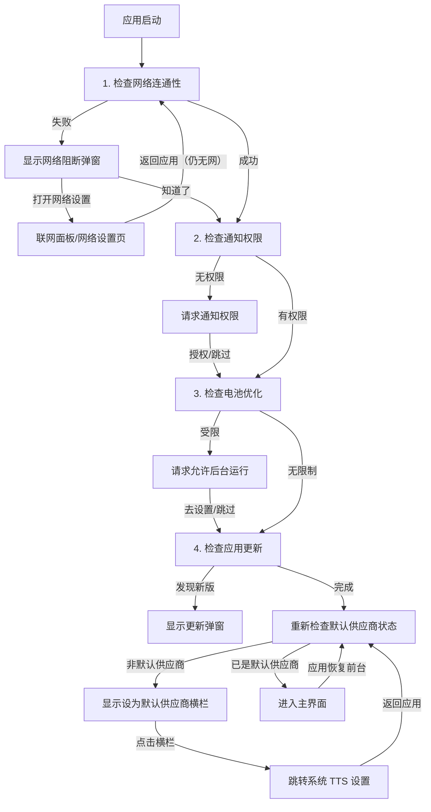

# Talkify 开发指南

本文档旨在为 Talkify 项目的开发者提供全方位的技术指导，涵盖架构设计、核心流程、代码规范及扩展指南。

## 目录

1. [项目概述](#1-项目概述)
2. [快速开始](#2-快速开始)
3. [技术架构](#3-技术架构)
4. [关键业务流程](#4-关键业务流程)
5. [配置存储方案](#5-配置存储方案)
6. [UI 与设计规范](#6-ui-与设计规范)
7. [扩展指南：添加新供应商](#7-扩展指南添加新供应商)
8. [发布与版本控制](#8-发布与版本控制)

---

## 1. 项目概述

Talkify 是一款基于 Android 的现代化 TTS (Text-to-Speech) 桥接应用。它不产生语音，而是作为**连接器**，将云端大模型（如通义千问、豆包、腾讯云）的高质量语音合成能力，以及基于 sherpa-onnx 的本地离线语音合成能力，通过 Android 标准 TTS 接口提供给系统和第三方阅读软件使用。

### 1.1 核心特性
- **云端驱动**：接入阿里云百炼（DashScope）、火山引擎（Volcengine）、腾讯云、微软 Azure、**MiniMax**、**小米 MiMo**、**Google Gemini TTS** 和 **OpenAI** 的流式 API。
- **本地离线**：基于 sherpa-onnx 引擎的 ZipVoice 流匹配零样本模型离线语音合成（参考音频定义音色），无需网络即可使用。
- **架构解耦**：采用插件化架构，轻松扩展新的 TTS 服务商（云端或本地均可）。
- **体验流畅**：完整的启动检查流程（网络/权限/电池优化），确保服务在后台稳定运行。
- **清爽界面**：配置项按使用频率分层展示，"高级设置"（API 地址、模型 ID 等）默认折叠，减少视觉干扰。

---

## 2. 快速开始

### 2.1 环境要求
- **IDE**: Android Studio Ladybug | 2024.2.1+
- **JDK**: JDK 17+（CI 构建环境为 JDK 21；编译目标为 Java 17 字节码，本地 17 及以上均可）
- **Android SDK**: API 37 (compileSdk/targetSdk) / minSdk 30

### 2.2 常用命令

项目使用 Gradle 进行构建管理：

```bash
# Debug 构建（开发调试）
./gradlew assembleDebug

# Release 构建（正式包）
./gradlew assembleRelease

# 代码检查 (Lint)
./gradlew lint

# 运行单元测试
./gradlew test

# 清理构建缓存
./gradlew clean

# 原生库 16KB 页对齐检查（发布门禁脚本，本地亦可运行）
python3 scripts/check_16kb_alignment.py app/build/outputs/apk/release/
```

### 2.3 依赖说明
关键依赖版本管理位于 `gradle/libs.versions.toml`：
- **UI**: Jetpack Compose BOM（版本以 `gradle/libs.versions.toml` 为准，下同）
- **Lifecycle**: runtime-ktx / process / viewmodel-compose / **runtime-compose** 2.11.0（`collectAsStateWithLifecycle` 用于 Compose 生命周期感知的状态收集）
- **Navigation**: Navigation Compose
- **Network**: OkHttp 4.12.0（锁定版本以兼容 DashScope SDK）
- **AI SDK**: DashScope SDK
- **Kotlin**: Kotlin Gradle 插件
- **AGP**: Android Gradle 插件
- **腾讯云TTS**: stream_tts-release-v2.0.16-20260128-d80cafe（本地 AAR，位于 `app/libs/`，由 `app/build.gradle.kts` 通过 `files()` 引入）
- **MP3解码**: JLayer 1.0.1 (用于微软TTS和MiniMax供应商的流式MP3解码)
- **本地TTS引擎**: sherpa-onnx v1.13.1（离线语音合成引擎，当前承载 ZipVoice 模型）。使用官方 **static-link-onnxruntime** 构建，以本地 AAR 引入（`app/libs/sherpa-onnx-static-link-onnxruntime-1.13.1.aar`，同腾讯云 AAR 的 `files()` 方式）。勿改回 JitPack 坐标 `com.github.k2-fsa:sherpa-onnx`——该构建动态链接全量 onnxruntime `.so`，曾是 APK 膨胀至 140MB 的主因。**必须在 `app/proguard-rules.pro` 保留 sherpa-onnx 与 `SherpaCallbackBridge` 的 keep 规则**：JNI 层按名字反射访问 `OfflineTtsConfig` 字段与回调方法，R8 混淆后会在 release 包崩溃（`fid == null` SIGABRT）。
- **压缩解压**: commons-compress 1.28.0（tar.bz2 解压，用于 ZipVoice 官方 tarball 等归档资源）
- **匿名统计**: Umami（自建实例，基础事件经 `/api/send` 上报，零 SDK 依赖，官方脚本源码存于 `doc/umami/`）。端点与网站 ID 经构建注入（N19-g）：`local.properties` 的 `umami.endpoint` / `umami.websiteId` 或 CI 环境变量 `UMAMI_ENDPOINT` / `UMAMI_WEBSITE_ID`，生成 BuildConfig 字段；未配置/配置非法时全部上报路径自检短路、零网络流量。debug 默认只使用 `umami.debugEndpoint` / `umami.debugWebsiteId`（缺省则不发送），**不会回退到生产站点**。界面诊断（回放/热图）为独立许可且当前版本整体停用

---

## 3. 技术架构

Talkify 严格遵循 **MVVM (Model-View-ViewModel)** 架构模式，配合 **Clean Architecture** 的分层思想，实现逻辑与 UI 的分离。

### 3.1 核心目录结构

```text
app/src/main/java/com/github/lonepheasantwarrior/talkify/
├── MainActivity.kt                       // 【容器】极简容器，设置导航图与音量控制
├── TalkifyApplication.kt                 // 【应用类】应用初始化、通知通道创建
├── TalkifyExceptionHandler.kt            // 【异常处理】全局未捕获异常处理器 + RxJava 全局错误策略
├── TalkifyAppHolder.kt                   // 【全局 Context】应用 Context 持有者（ServiceLocator）
├── TalkifyCheckDataActivity.kt           // 【检查页】供应商数据完整性校验
├── TalkifyDownloadVoiceDataActivity.kt   // 【契约页】系统 INSTALL_TTS_DATA 契约 Activity（NoDisplay 空壳，onCreate 即 finish）
├── TalkifySampleTextActivity.kt          // 【样本文本】预置示例文本管理
├── util/                                 // 【工具层】通用工具类
│   ├── TalkifyAudioPlayer.kt             // 音频播放工具（语音预览，预缓冲/排空/停止）
│   └── AudioOutput.kt                    // 音频输出抽象（AudioTrack 封装，供 JVM 测试注入替身）
├── domain/                               // 【领域层】纯 Kotlin 业务接口与模型
│   ├── model/                            // 供应商配置、更新信息等数据模型
│   │   ├── BaseProviderConfig.kt         // 供应商配置基类（voiceId/apiUrl/modelId）
│   │   ├── ConfigItem.kt                 // 配置项模型（placeholder/弹窗编辑器/指南内容等）
│   │   ├── ProviderIds.kt                // 供应商 ID 密封类（providerId/defaultModelId/provider）
│   │   ├── AliyunBailianConfig.kt         // 阿里云百炼（通义千问）供应商配置
│   │   ├── VolcengineConfig.kt           // 火山引擎（豆包 Seed TTS）供应商配置
│   │   ├── TencentCloudConfig.kt         // 腾讯云语音合成供应商配置
│   │   ├── AzureConfig.kt                // 微软 Azure 语音合成供应商配置
│   │   ├── MiniMaxConfig.kt              // MiniMax 语音合成供应商配置
│   │   ├── XiaomiConfig.kt               // 小米 MiMo 语音合成供应商配置
│   │   ├── GoogleConfig.kt               // Google Gemini TTS 供应商配置（含接口规范与代理设置）
│   │   ├── OpenAIConfig.kt               // OpenAI 语音合成供应商配置（含代理设置）
│   │   ├── LocalModelConfig.kt            // 本地模型配置（voiceId, modelId, apiUrl）
│   │   ├── LocalModelInfo.kt              // 本地模型元数据（modelType, downloadFileInfo, voiceList, 采样率, 支持语言）
│   │   ├── LocalModelRegistry.kt          // 本地模型注册表（模型清单、下载源、语音列表的统一数据源）
│   │   ├── TtsProviderRegistry.kt        // 供应商注册中心（基于 ProviderIds 管理供应商元信息）
│   │   ├── TtsModels.kt                  // TTS 相关数据模型
│   │   ├── UpdateCheckResult.kt          // 更新检查结果模型
│   │   └── UpdateInfo.kt                 // 更新信息模型
│   └── repository/                       // 仓储接口定义 (Repository Interfaces)
│       ├── AppConfigRepository.kt        // 应用配置仓储接口
│       ├── ProviderConfigRepository.kt   // 供应商配置仓储接口
│       └── VoiceRepository.kt            // 音色仓储接口
├── infrastructure/                       // 【基础设施层】技术实现细节
│   ├── app/                              // 应用级设施
│   │   ├── notification/                 // 通知管理
│   │   │   ├── NotificationHelper.kt      // 通知通道创建与通知构建
│   │   │   ├── NotificationModels.kt      // TalkifyNotificationChannel 枚举、NotificationIds、通知数据类
│   │   │   └── TalkifyNotificationHelper.kt // 业务通知快捷发送
│   │   ├── permission/                   // 权限管理
│   │   │   ├── ConnectivityMonitor.kt
│   │   │   ├── NetworkConnectivityChecker.kt
│   │   │   └── PermissionChecker.kt
│   │   ├── power/                        // 电源管理
│   │   │   └── PowerOptimizationHelper.kt
│   │   ├── telemetry/                    // 匿名遥测统计
│   │   │   ├── TelemetryController.kt     // 许可/前后台/policyEpoch/录制生命周期唯一写入口
│   │   │   ├── TalkifyTelemetry.kt        // 遥测门面（业务层唯一事件入口）
│   │   │   ├── UmamiClient.kt             // Umami 传输层（有界队列/顺序发送/响应分类）
│   │   │   ├── TelemetryQueue.kt          // 有界事件队列（256 条/512KiB/60s TTL）
│   │   │   ├── UmamiSessionState.kt       // 会话令牌/代际/远端停用状态（单写者）
│   │   │   ├── TelemetrySchema.kt         // 事件注册与类型/长度/隐私约束
│   │   │   ├── TelemetryIds.kt            // 模型/音色自定义值归类（custom）
│   │   │   ├── TelemetryDiagnostics.kt    // 本地诊断计数（不含 payload/令牌）
│   │   │   ├── CrashReporter.kt           // 崩溃摘要本地留存与下次启动补报
│   │   │   ├── DeviceInfoCollector.kt     // 匿名设备信息收集（零权限）
│   │   │   ├── TtsTelemetryTracker.kt     // TTS 请求终态（入口建模/框架交付校验/抽样明细）
│   │   │   ├── TtsMetricsAggregator.kt    // TTS 固定窗口有界汇总（tts_metrics_window）
│   │   │   ├── ScreenTracker.kt           // 真实页面 pageview 唯一责任方
│   │   │   ├── AppActionTracker.kt        // 应用动作事件（点击/前台/崩溃补报）
│   │   │   ├── AppPageTracker.kt          // 抽屉/弹窗打开事件（surface_opened，非 pageview）
│   │   │   └── recorder/                  // 录制子系统（当前整体停用，代码保留待验收）
│   │   │       ├── UmamiRecorder.kt       // recorder 门面（总开关关闭；会话绑定/丢弃语义）
│   │   │       ├── UmamiRecorderConfig.kt // 服务端配置探测（拒绝 blockSelector、本地硬上限）
│   │   │       ├── RecordTransport.kt     // /api/record 传输层（最终包体预算/分片/单调时间戳）
│   │   │       ├── Rrweb.kt               // rrweb 事件协议常量与事件构造器
│   │   │       ├── UiSnapshot.kt          // 语义树中间表示（含 masked 子树标记）
│   │   │       ├── RrwebSnapshotBuilder.kt // rrweb DOM 快照序列化器（纯函数，祖先遮罩兜底）
│   │   │       ├── ReplaySession.kt       // 回放会话（无障碍树捕获 → rrweb 事件流）
│   │   │       └── HeatmapSession.kt      // 热图会话（点击/滚动深度状态机）
│   │   ├── update/                       // 更新检查
│   │   │   └── UpdateChecker.kt         // GitHub API 版本检查
│   │   └── repo/                         // 配置仓储实现
│   │       └── SharedPreferencesAppConfigRepository.kt
│   ├── security/                         // 值级加解密（历史密文迁移 + 备份期加解密预留）
│   │   ├── CipherTextFormat.kt           // `enc:v1:` 密文格式纯函数层（JVM 可单测）
│   │   └── PrefsValueCipher.kt           // Keystore AES-256-GCM 加解密器
│   ├── provider/                         // 供应商级设施
│   │   └── repo/                         // 供应商仓储实现（统一继承泛型基类）
│   │       ├── BasePrefsConfigRepository.kt   // 配置仓储泛型基类（serialize/deserialize 映射 + 历史密文迁移）
│   │       ├── KeyValueStore.kt               // 键值存储抽象（SharedPreferences 实现，测试注入点）
│   │       ├── AliyunBailianConfigRepository.kt
│   │       ├── AliyunBailianVoiceRepository.kt
│   │       ├── VolcengineConfigRepository.kt
│   │       ├── VolcengineVoiceRepository.kt
│   │       ├── TencentCloudConfigRepository.kt
│   │       ├── TencentCloudVoiceRepository.kt
│   │       ├── AzureConfigRepository.kt
│   │       ├── AzureVoiceRepository.kt
│   │       ├── MiniMaxConfigRepository.kt
│   │       ├── MiniMaxVoiceRepository.kt
│   │       ├── XiaomiConfigRepository.kt
│   │       ├── XiaomiVoiceRepository.kt
│   │       ├── GoogleConfigRepository.kt
│   │       ├── GoogleVoiceRepository.kt
│   │       ├── OpenAIConfigRepository.kt
│   │       ├── OpenAIVoiceRepository.kt
│   │       ├── BaseXmlVoiceRepository.kt      // XML 音色仓储基类（IO 调度器解析 + 供应商校验 + 映射钩子）
│   │       ├── LocalModelConfigRepository.kt // 本地模型配置仓储（SharedPreferences）
│   │       └── LocalModelVoiceRepository.kt  // 本地模型音色仓储（从 Registry 读取，构造注入配置仓储）
│   │   └── local/                         // 本地模型基础设施
│   │       ├── SherpaTtsEngine.kt         // sherpa-onnx 引擎封装（ZipVoice 初始化与合成）
│   │       ├── SherpaCallbackBridge.java  // JNI 回调桥接（Java 端回调接口，供 C++ 引擎调用）
│   │       ├── LocalVoiceCatalog.kt       // 内置音色目录（res/xml 清单 + assets/voices/ 参考音频）
│   │       ├── WavSampleReader.kt          // PCM16 WAV 解码（参考音频 → 归一化浮点样本）
│   │       ├── LocalModelManager.kt       // 模型生命周期管理（下载状态、完整性校验、文件路径、残留清理）
│   │       └── LocalModelDownloadService.kt // 前台下载服务（Notification + 进度通知）
│   └── xml/                              // XML 资源解析工具
│       ├── VoiceXmlEntry.kt              // 音色 XML 条目数据类
│       └── VoiceXmlParser.kt             // 音色 XML 解析器
├── service/                              // 【服务层】Android Service 实现
│   ├── TalkifyTtsService.kt              // 系统 TTS 服务入口
│   ├── TtsPreviewPlayer.kt               // 语音预览播放器（供应商合成 + 本地播放，非 Android Service）
│   ├── TtsErrorCode.kt                   // 错误码定义（错误消息、Android 错误映射与推断；原 TtsErrorHelper 已并入）
│   ├── TtsLogger.kt                      // 日志工具（release 构建关闭调试日志，P1-13）
│   ├── provider/                         // TTS 供应商统一抽象
│   │   ├── AbstractTtsProvider.kt        // 供应商抽象基类（元数据钩子下沉）
│   │   ├── HttpStreamingTtsProvider.kt   // HTTP 流式供应商模板基类（共享 OkHttp + 分块流水线挂载）
│   │   ├── ChunkPipelineExecutor.kt      // 分块预取流水线执行器（窗口=2，按序 flush，背压）
│   │   ├── TtsProviderApi.kt             // 供应商接口定义
│   │   ├── TtsProviderFactory.kt         // 供应商工厂
│   │   ├── AudioConfig.kt                // 音频配置
│   │   ├── TextChunkSplitter.kt          // 文本分块工具（按句子边界智能切分）
│   │   ├── Mp3StreamDecoder.kt           // MP3 流式解码器（共享 JLayer 解码循环）
│   │   ├── HexCodec.kt                   // 十六进制音频解码（查表实现）
│   │   ├── ParamMappers.kt               // Android TTS 参数 → 各供应商 API 参数映射
│   │   ├── ProxySetting.kt               // 代理配置解析（协议/主机/端口 → java.net.Proxy）
│   │   ├── ProviderErrorParsers.kt       // 各供应商错误响应 → 中文消息映射
│   │   ├── WavHeaderSanitizer.kt         // WAV 头识别与剥离
│   │   ├── PcmFrameAssembler.kt          // PCM 字节流帧对齐（跨网络分块拼接不足一帧的尾字节）
│   │   └── impl/                         // 具体供应商实现
│   │       ├── AliyunBailianProvider.kt
│   │       ├── VolcengineProvider.kt     // 继承 HttpStreamingTtsProvider（接入预取流水线）
│   │       ├── TencentCloudProvider.kt
│   │       ├── AzureProvider.kt
│   │       ├── MiniMaxProvider.kt
│   │       ├── XiaomiProvider.kt         // 继承 HttpStreamingTtsProvider（接入预取流水线）
│   │       ├── GoogleProvider.kt         // 继承 HttpStreamingTtsProvider（Gemini TTS 双接口规范门面：分派 + SSE 循环 + 代理支持）
│   │       ├── GoogleApiSpec.kt          // Google 接口规范抽象（端点/请求体/事件提取）+ base64 解码共享工具
│   │       ├── GoogleInteractionsApi.kt  // interactions 规范实现（默认，POST /v1beta/interactions）
│   │       ├── GoogleGenerateContentApi.kt // generateContent 规范实现（POST /v1beta/models/{model}:streamGenerateContent?alt=sse）
│   │       ├── OpenAIProvider.kt         // 继承 HttpStreamingTtsProvider（/v1/audio/speech raw PCM 流式 + 代理支持）
│   │       └── LocalModelProvider.kt       // 本地模型离线合成供应商（sherpa-onnx，引擎空闲自动释放）
└── ui/                                   // 【表现层】Jetpack Compose UI
    ├── components/                       // 通用 UI 组件
    │   ├── BatteryOptimizationDialog.kt
    │   ├── ConfigBottomSheet.kt          // 配置弹窗（含本地模型选择、下载状态显示、下载触发）
    │   ├── ConfigEditor.kt
    │   ├── ProviderSelector.kt
    │   ├── MarkdownText.kt
    │   ├── NetworkBlockedDialog.kt       // 网络阻断弹窗（离线可用性自适应文案，可"知道了"继续）
    │   ├── NotificationPermissionDialog.kt
    │   ├── UpdateDialog.kt
    │   ├── VoicePreview.kt
    │   ├── EqualizerBars.kt           // 均衡器风格波形条
    │   ├── VoiceWaveBars.kt           // 语音波形可视化（AGSL）
    │   └── TelemetryCaptureHost.kt    // 遥测录制的事件采集宿主
    ├── screens/                           // 页面级 Composable
    │   ├── MainScreen.kt                  // 主界面（含默认供应商提示、关于应用提示横栏、语音预览、供应商配置）
    │   └── AboutScreen.kt                 // 关于页面（含检查更新、打赏功能）
    ├── viewmodel/                         // 状态管理（组合根 + 领域控制器）
    │   ├── MainViewModel.kt              // 组合根：聚合三个状态域暴露给 MainScreen
    │   ├── startup/StartupCoordinator.kt // 启动检查状态机（网络/权限/电池/更新/默认供应商）
    │   ├── preview/PreviewPlaybackController.kt // 语音预览状态与播放控制
    │   └── localmodel/LocalModelDownloadController.kt // 下载进度、广播接收、冲突检测
    └── theme/                            // Material 3 主题定义
        ├── Color.kt
        ├── Theme.kt
        ├── Type.kt
        └── Motion.kt                      // 动效规范（过渡/弹簧参数）
```

### 3.2 架构设计详解

#### 3.2.1 启动流程架构 (MVVM)
应用启动涉及多个复杂的异步检查步骤。为了避免 `MainActivity` 代码膨胀和弹窗冲突，我们采用 **State Machine（状态机）** 模式：

- **ViewModel (`MainViewModel`)**: 维护单一真实数据源 `startupState` (`StartupState`)。它按顺序调度检查任务，控制流程流转。
- **View (`MainScreen`)**: 响应式 UI。根据 `startupState` 的变化（如 `CheckingNetwork`, `CheckingBatteryOptimization`）动态切换显示的弹窗或内容。
- **Activity (`MainActivity`)**: 极简容器，不处理任何逻辑。

#### 3.2.2 TTS 供应商架构 (Plugin-based)
供应商模块采用接口隔离设计，确保新增供应商不影响现有代码：
- **`TtsProviderApi`**: 定义标准行为（合成、停止、释放、声音查询、配置标签、默认 API 地址/模型 ID 暴露等），配套 `SynthesisParams` 封装合成参数。
- **`TtsSynthesisListener`**: 合成结果回调接口，支持音频数据流式回传、错误处理和完成通知。
- **`AbstractTtsProvider`**: 提供通用实现（日志、释放状态检查、可朗读文本检测、元数据方法下沉）。音色/语言类元数据基于钩子属性实现：
  - `voiceIds`（XML 音色列表）/ `fallbackVoiceId`（兜底音色）/ `supportedLanguages`（支持语言）/ `configLabels`（配置项标签映射）
  - 基类据此统一实现 `getSupportedVoices()` / `getDefaultVoiceId()` / `isVoiceIdCorrect()` / `getSupportedLanguages()` / `getDefaultLanguage()`（对齐 `TextToSpeechService#onGetLanguage` 的 [lang, country, variant] 三元组契约）/ `getConfigLabel()`
  - 音色模型特殊的供应商（阿里云 SDK 枚举、Azure、本地模型注册表）直接覆写对应方法
  - `isConfigured()` 经类型安全的 `isConfiguredAs<C>(config) { predicate }` 实现
  - **合成会话代数**（P1-15）：`beginSynthesisSession()` 入口自增代数并捕获快照，`isSynthesisSessionActive(session)` 供全部回调出口校验，`invalidateSynthesisSession()` 由 `stop()` 作废当前会话——取消是协作式的，旧协程在取消信号生效前可能仍产出音频/错误回调，过期回调据此统一静默丢弃
- **`HttpStreamingTtsProvider`**: HTTP 流式供应商模板基类（火山引擎、小米 MiMo、Google、OpenAI 继承）。统一负责：
  - 合成入口校验（配置/空文本/可读文本）与 `TextChunkSplitter` 分块
  - 分块预取流水线（`ChunkPipelineExecutor`）与音频按序 flush
  - 全局共享 OkHttpClient（连接池复用，keep-alive 45s）
  - 请求级取消（in-flight call 集合管理 + 入口显式取消上一会话协程）、首个音频块触发 `onSynthesisStarted`；HTTP 响应体统一 `use { }` 收口（连接归还不再依赖子类自觉）
  - **PCM 帧对齐**（`PcmFrameAssembler`）：HTTP 分块边界可能切断 16bit 采样帧，`emitAudio` 出口统一把不足一帧的尾字节留到下一分块拼接，只向监听器交付完整帧——避免 AudioTrack/SynthesisCallback 丢弃尾字节后全部样本错位（表现为持续刺耳噪声）。对齐器随 fetch 协程隔离，并发预取互不串扰
  - 子类仅实现 `validateConfig` / `buildHttpRequest` / `processStreamResponse` / `mapHttpError` / `chunkMaxLength`
  - **明文端点拦截**（N19-f）：子类在 `validateConfig` 中调用 `validateCleartextEndpoint(apiUrl)`，用户自定义 `http://` 端点在配置校验层即报可操作错误——平台默认禁明文是安全资产，刻意不开 networkSecurityConfig 白名单
  - **网络行为定制钩子** `httpClientFor(config)`：默认返回全局共享客户端；需要经代理访问的供应商（如 Google）覆写它，并调用 `proxiedHttpClient(setting)` 基于共享客户端派生走 HTTP/SOCKS 代理的实例（`newBuilder()` 复用共享连接池，结果按代理参数缓存）。代理配置解析由纯函数 `ProxySettings.parse`（`ProxySetting.kt`）承担，供校验、构建客户端与单元测试复用
- **共享纯函数工具**（可单元测试）：`Mp3StreamDecoder`（JLayer 解码循环）、`HexCodec`（hex 音频查表解码）、`ParamMappers`（参数映射）、`ProviderErrorParsers`（错误消息映射）、`WavHeaderSanitizer`（WAV 头剥离）、`PcmFrameAssembler`（PCM 帧对齐）。
- **`AbstractTtsProvider` 之外的特例**：`AliyunBailianProvider` 使用 DashScope SDK 独立实现串行分块（SDK 全局 `Constants.baseHttpApiUrl` 静态端点限制，"端点覆写 + streamCall 订阅"经互斥锁成对持锁——服务与预览两实例并行且自定义地址不同时不会互相串台（P1-16），并同样接入会话代数防过期回调）；`TencentCloudProvider` 受官方 SDK 会话模型限制保持串行分块（单块 30s 超时保护）。`LocalModelProvider` 继承 `AbstractTtsProvider`（元数据钩子 + 动态采样率 `getAudioConfig()`），引擎管理自行实现。
- **`TtsProviderRegistry`**: 供应商注册中心，以 `ProviderIds` 密封类为单一数据源（每个子对象包含 `providerId` 唯一标识、`defaultModelId` 默认模型、`provider` 展示名称三个属性），管理所有可用供应商元信息，并通过 `ProviderIds.toTtsProvider()` 扩展函数转换为 UI 数据模型 `TtsProvider`。
- **`TtsProviderFactory`**: 供应商实例工厂，基于 DCL（双重检查锁定）延迟初始化注册表，统一管理 Provider、ConfigRepo、VoiceRepo 三种组件的创建，是插件化架构的核心入口。

##### 分块预取流水线（ChunkPipelineExecutor）

火山引擎与小米 MiMo 的长文本按块（300/768 字符）流式合成。串行模式下块间插入一次完整网络往返（RTT + 首包延迟），产生规律性停顿。流水线以滑动窗口（window=2）让当前块音频传输期间后续块请求已在服务端排队：

- **顺序不变量**：音频 flush 严格按块序号进行；后续块音频暂存于块级有限容量 Channel（64 条，越界即背压挂起 fetch，TCP 层反压服务端）
- **取消**：`stop()` 标记 + 取消全部 in-flight HTTP 请求；块失败时取消剩余请求，失败块之后的内容不再输出
- **音频通道传递**：sink 经协程上下文元素（`AudioSinkElement`）注入，并发 fetch 无共享状态
- **边界**：单块文本自动退化为直连路径；Azure（自有 WebSocket 流水线）、阿里云/腾讯（SDK 限制）不接入

##### 自定义 API 地址与模型 ID
每个供应商通过 `getDefaultApiUrl()` 和 `getDefaultModelId()` 暴露其默认端点和模型标识：
- 用户可在配置界面自定义 API 地址和模型 ID，未配置时自动回退到供应商默认值
- 合成时通过 `config.apiUrl.ifBlank { defaultApiUrl }` 实现优先级回退
- 当用户自定义了模型 ID 时，供应商选择器和列表中的"模型名称"展示会自适应更新
- 不支持自定义的供应商（如腾讯云使用官方 SDK）返回空字符串，配置界面自动隐藏对应字段

#### 3.2.3 应用初始化架构
- **`TalkifyApplication`**: 应用入口类，负责：
  - 初始化 `TalkifyAppHolder` 全局上下文（供供应商等组件获取 Context）
  - 注册 `TalkifyExceptionHandler` 全局异常处理器
  - 日志门控（P1-13）：按 `FLAG_DEBUGGABLE` 设置 `TtsLogger` 调试开关——release 构建关闭 debug 日志，用户朗读原文等敏感内容不进系统 logcat
  - 初始化 `TelemetryController`（必须在 onCreate 完成，TTS 服务可在无 Activity 场景产生合成事件）：读取统计/诊断两个独立许可、建立新的许可代际；统计开启时在后台补报上次遗留的崩溃摘要（不依赖 Activity），关闭时清除待补报摘要
  - 预创建两个通知通道：`TTS_PLAYBACK`（前台服务常驻）和 `SYSTEM_NOTIFICATION`（系统级通知）
  - 注册 `ProcessLifecycleOwner` 应用级生命周期观察：只向 `TelemetryController` 发送前后台信号。页面计数、`app_foregrounded` 与设备画像由控制器统一处理；启动信号不挂在 `Application.onCreate`，因为 TTS 前台服务常驻、任务划走后进程仍存活，重开应用不会重建进程
- **`TalkifyExceptionHandler`**: 全局未捕获异常处理器（`initialize()` 幂等，重复调用不重复安装；进程级状态仅供单测复位），捕获崩溃后：
  - 发送系统通知提示用户
  - `CrashReporter` 在崩溃现场只写本地受限摘要（异常类名链、应用代码栈帧签名、线程类型、构建版本；不联网、不等待），随后交还系统默认处理器终止进程——交还经 try/finally **无条件执行**，通知/摘要链路任何一环抛出都不会让崩溃线程悬挂（无默认处理器时兜底 `Process.killProcess`）
  - 不实现崩溃对话框：应用上下文无法挂载 Dialog（BadTokenException）；主线程崩溃时 looper 已阻塞、后台线程崩溃时进程随默认处理器立即终止，对话框在两种场景下均不可达
  - **RxJava 全局错误策略**（`installRxJavaErrorPolicy`，随 `initialize()` 一并装配）：阿里云百炼供应商的 DashScope SDK 基于 RxJava 2 实现流式合成，停止/暂停朗读 dispose 订阅后，在途流错误会成为"无消费者的孤儿错误"路由到 `RxJavaPlugins.onError`（非 bug 类异常统一包装为 `UndeliverableException`），未配置全局处理器时默认走线程未捕获异常链路、直接杀死常驻 TTS 进程。策略分诊：`UndeliverableException` 记 ERROR 日志 + `rx_suppressed` 遥测后吞掉（刻意不做内因类型白名单——SDK 各版本各传输路径的包装类型不稳定，"错误无处投递"才是跨版本稳定边界）；其余 `isBug` 六类裸形态异常维持既有崩溃链路。整体 try-catch 防御——错误处理器自身再抛异常会被 RxJava 兜底路由回未捕获链路。根因分析与验证的完整记录在内部文档 `doc/local/崩溃问题修复方案.md`（该目录为本仓库约定不入库的本地工作区，外部贡献者可参见本节结论概述）
- **`TalkifyAppHolder`**: 全局 Context 持有者，避免供应商层对 Android 组件的直接依赖

#### 3.2.4 匿名遥测架构 (Umami)

Talkify 集成自建 [Umami](https://umami.is/) 实例进行**隐私优先**的匿名使用统计，帮助开发者了解核心功能使用情况与合成质量趋势。遥测经 Umami 的 `POST /api/send` HTTP 接口上报，**无任何 SDK 依赖**（复用工程内已有的 OkHttp 与 org.json）。

> 本节的指标口径、事件 schema 与限制是**实现契约**。修改前先阅读 `logs/数据上报功能整改方案.md` 的 U01–U13；任何"看起来更丰富"但破坏分母完整性、用户撤回或隐私边界的改动都不可接受。

##### 两条独立许可

| 许可 | 持久化键 | 默认 | 覆盖范围 |
|------|---------|------|---------|
| 匿名使用统计 | `telemetry_enabled` | 开启 | `/api/send` 基础事件、TTS 汇总、崩溃补报 |
| 界面诊断 | `diagnostics_enabled` | **关闭** | 语义树采集、触摸轨迹、回放/热图、`/api/record` |

- 两条许可互相独立：既有 `telemetry_enabled=true` 不会被迁移为已开启诊断；服务端只能进一步收紧本地许可，不能自行启用用户未选择的能力。
- **当前版本界面诊断能力整体停用**（`UmamiRecorder.RECORDING_IMPLEMENTATION_ENABLED = false`）：不探测录制配置、不采语义树、不缓存轨迹、不产生 `/api/record` 流量。设置页诊断开关显示为不可用；恢复前必须完成 U01/U09/U10 的验收（见下文）。
- 关闭统计时：先禁止新采集/发送，再在同一串行边界内清空待发队列并取消已登记的 Call；关闭返回后旧 epoch 的发送线程无法再登记新 Call，旧响应也不能写入新会话。随后清空会话缓存、丢弃录制缓冲、清除待补报摘要。已经写入网络的字节无法撤回，这是客户端能力的硬边界。
- 重新开启：推进许可代际，只上报当前真实页面作为新会话锚点，不补发关闭期间的事件；关闭期间创建或在途的 TTS attempt、设备画像任务、窗口汇总与崩溃提交都携带旧代际快照，不会因重新开启而复活。

##### 分层设计

| 层 | 组件 | 职责 |
|----|------|------|
| 控制器 | `TelemetryController` / `TelemetryPolicyState` | 许可持久化、`CollectionPermit` 原子捕获、`policyEpoch`、前后台信号、崩溃补报与录制生命周期的唯一写入口 |
| 门面 | `TalkifyTelemetry` | 业务层唯一事件入口，支持传入异步生产者创建时捕获的许可 |
| 语义层 | `TtsTelemetryTracker` / `AppActionTracker` / `AppPageTracker` / `ScreenTracker` | 事件 schema、TTS 终态、动作事件、真实页面 pageview、界面容器事件 |
| 汇总层 | `TtsMetricsAggregator` | 固定窗口的有界 TTS 指标汇总，带可取消到期任务 |
| 契约层 | `TelemetrySchema` / `TelemetryIds` / `TelemetryConfigValidator` | 每事件字段白名单、类型/枚举/范围/UTF-8 字节校验、配置严格校验、模型与音色分类 |
| 传输层 | `UmamiClient` / `TelemetryQueue` / `UmamiSessionState` / `RetryGate` | 有界队列、单顺序发送器、会话令牌与代际、协议分类与站点级限流 |
| 画像层 | `DeviceInfoCollector` | 匿名设备信息收集（零权限） |
| 诊断层 | `TelemetryDiagnostics` / `CrashReporter` | 本地丢弃/错误计数、崩溃摘要本地留存与启动补报 |
| 录制层（停用） | `recorder/*` | 保留协议实现与隐私防线，等待独立验收 |

##### 许可代际与发送顺序

- `policyEpoch` 每次许可变更自增。异步生产者（TTS attempt、设备画像、窗口汇总、崩溃摘要）在**创建时**捕获不可变 `CollectionPermit`，提交时要求仍为同一有效代际；关闭期间创建或跨代际的旧数据不上报。
- “复核许可 + 登记 Call”和“关闭许可 + 取消已登记 Call”使用同一把串行锁；网络执行在锁外。关闭先完成时，发送线程后续登记会看到旧 epoch 并放弃；登记先完成时，Call 在关闭返回前已被取消。响应回写同样按 `expectedPolicyEpoch` 校验。
- 基础发送由 **单 worker 顺序执行**：队列 FIFO → 构造 JSON → 同步 HTTP → 解析响应 → 更新会话。因此响应不会乱序覆盖新令牌。
- `UmamiClient` 使用独立 `OkHttpClient` 与独立线程，关闭统计只取消遥测 Call，**不会影响 TTS 合成请求**。
- 基础事件队列上限 **256 条 / 512KiB / 60s TTL（单调时钟）**。每事件最终 data 按组装公共属性后的 UTF-8 JSON 字节数硬限制 4KiB；队列预算使用同一字节数。资源不足时丢弃遥测而不是阻塞朗读，并按 `queue_full` / `ttl_expired` / `policy_disabled` / `remote_disabled` / `schema_rejected` / `send_failed` 分别计数。
- 2xx 只有符合部署契约（带非空字符串 `cache` 的 JSON）才算成功；空体、HTML、畸形 JSON、字段类型错误和超过 16KiB 的响应计为**协议错误**，不更新令牌、不增加成功计数。
- 400 先判断请求是否真的携带令牌以及错误是否指向令牌：仅明确令牌失效时清除缓存并受控重建一次；schema/配置/站点不存在等 400 按拒绝处理，不重试。
- `Retry-After` 完整支持秒数与三种 HTTP-date，不截短；`RetryGate` 维护站点级 `nextAllowedAt`，在允许时刻前不发送后续事件。**每一次限流响应都先更新站点冷却，再独立决定当前事件是否重试**：即使本次已是最后一次尝试（重试预算耗尽），该响应的 `Retry-After` 仍约束后续事件。等待若超过事件 TTL 则丢弃，不提前重试；等待期间关闭许可会立即结束等待。429/5xx 计入 HTTP 诊断，5xx 临时错误指数退避加抖动，最多重试 2 次；过滤、明确拒绝与远端停用不重试。
- 入队后只承诺 **Accepted / Dropped**，不宣称 Delivered；没有服务端幂等支持时，超时重试可能重复。

##### 会话一致性

- `UmamiSessionState` 分开维护 `policyEpoch`、`sessionEpoch`、令牌与远端停用状态；会话写入只由发送 worker 与控制器许可切换在串行边界内执行。
- 基础成功响应必须携带非空 `cache`；按序应用并推进 `sessionEpoch`。`{disabled:true}` 或 `{ok:false,reason=disabled}` 覆盖基础事件与录制通道并清空待发队列。所有响应应用前复核捕获时的 `policyEpoch`，旧响应不能清掉新会话令牌或停用新代际。
- 录制缓冲绑定创建时的不可变 `RecordSession`（website、令牌、`sessionEpoch`、`policyEpoch`）；令牌轮换/许可关闭后旧缓冲自动失效，绝不会改挂新令牌。
- 每个前台会话允许一次远端停用复核（`onForegroundProbe`）；该探测不额外制造请求，只在下一个真实事件/页面访问时生效。

##### 页面与前台口径

**只有一个责任方**：整页 pageview 由 `ScreenTracker` 上报。`TalkifyApplication` 只发送前后台生命周期信号，`MainActivity` 只同步 NavController 当前路由。

- 冷启动：当前真实页面 1 条 pageview（主界面 `/` 或恢复时的 `/about`）。
- 切后台再回来：对当前真实页面各上报 1 条；从系统设置返回属于 `resume`，不是冷启动。
- 旋转/重组/Activity 重建：同一前台场次同一路径 0 条新增。
- 抽屉/弹窗：不再伪造 pageview，统一上报 `surface_opened` 事件（有限枚举 `surface_id` + 触发来源 `source`），不增加 Views、路径或跳出率。
- 系统 TTS / 下载服务事件使用固定路径 `/tts-service`、`/download-service` 与 `event_source=tts_service/download_service`，不伪装成主页点击。
- 自定义事件默认自动附带当前真实 `screen`；显式传入的关于页事件使用 `/about`。

**App 活跃口径**：`app_foregrounded` 仅表示"应用回到前台"，属性 `foreground_source=cold/resume`。Umami 的 Visitors/Visits 只是基于 IP + User-Agent 的匿名访客估算，**不是设备 DAU、启动次数或留存**；后台 TTS 使用量从 `tts_metrics_window` 计算，不补虚拟主页 pageview。默认不引入跨安装持久 ID，因此无法精确计算设备 DAU/跨周期留存。

**schema 迁移**：`schema_version=2` 起，抽屉/弹窗不再计入 Views（改为 `surface_opened` 事件），TTS 逐次明细改为 `tts_request_result` + `tts_metrics_window`。历史虚拟页面浏览量、旧成功率与新口径**不能直接同比**，报表中须标注迁移版本与日期。

##### TTS 请求终态（`tts_request_result`）

从**请求入口**建立 attempt，按 `validation → preparation → synthesis → framework_delivery` 记录阶段：

- `status`：`success / error / timeout / cancelled / ignored`
- `success` **仅**表示"供应商完成 + 至少一段音频被系统 TTS 框架接受 + `done()` 返回 SUCCESS"；对外只能称**框架交付成功率**，不能推导为用户完整听到音频的比例。
- `ignored`：空文本等未进入有效合成的请求，单独计数，不进入成功率分母。
- `failure_stage`：失败阶段；`error_code`：错误码或有限失败原因。
- `has_audio` (0/1)、`audio_bytes`、`provider_completed` (0/1)、`prepare_ms`、`synthesis_ms`、`first_audio_ms`、`sample_rate`。
- `first_audio_ms` 是**供应商首次回调音频**的延迟，不是扬声器首次出声延迟；未收到音频时不写该字段（不写 0ms）。
- 失败（error/timeout/cancelled）全量保留；成功按**请求产生前**统一概率抽样 5%（`sampled=1`），不能按结果分别抽样。

| 属性 | 说明 |
|------|------|
| `provider_id` | 供应商 ID |
| `model_id` / `model_category` | 生效模型：`default` / `builtin` / `custom`（准备阶段未解析时为 `unknown`）；自定义 ID 只记 `custom` |
| `voice_id` / `voice_category` | 生效音色：默认、内置白名单原样，自定义声音只记 `custom`（未解析时为 `unknown`） |
| `text_length` | 待合成字数 |
| `status` / `failure_stage` / `error_code` | 终态与阶段 |
| `duration_ms` / `duration_bucket` | 请求总耗时（入口 → 终态） |
| `prepare_ms` / `synthesis_ms` | 准备阶段与供应商合成阶段耗时 |
| `has_audio` / `audio_bytes` / `provider_completed` | 框架交付证据 |
| `first_audio_ms` / `sample_rate` | 首包延迟与采样率（成组出现） |
| `sampled` | 成功明细是否抽样 |

##### TTS 窗口汇总（`tts_metrics_window`）

高频合成不逐条全量上送。`TtsMetricsAggregator` 按 `provider_id + model_category` 聚合，窗口 **5 分钟或 500 请求**（先到者）发送一次，维度上限 32 个（超出归入 `other`）。

- 第一个有效结果建立窗口时安排独立的、可取消的一次性到期任务；即使之后没有新请求，到期也会发送。第 500 个结果入账后立即冲刷，不等待第 501 次。
- 窗口计时使用单调时钟，墙上时间只写入 `window_start_s/window_end_s`；`text_chars` 用 Long 累加后再限幅。
- 窗口绑定创建时的许可代际；到期与第 500 次竞争只消费一次。许可校验与窗口变更经 `PermitCommitBoundary` **原子提交**（锁顺序固定为许可锁 → 窗口锁）：关闭/重开要么发生在提交前（旧提交整体失效），要么发生在提交后（由撤回清理旧窗口），不会插入两者之间。旧代际的迟到 `record`/`flush` 不能替换、删除或冲刷新代际窗口；撤回清理只清除早于当前代际的窗口，不会取消新窗口的定时任务。`discardStale()` 当前由 `TelemetryController.setTelemetryEnabled` 在控制器监视器内同步调用，因此清理与下一次重开串行；`currentPermit()` 只是许可快照，若将来改为独立异步清理，必须改用与窗口变更同等的原子提交边界，不能只做一次锁外检查。仅由后台 TTS 服务启动的进程也能按时汇总；服务 `onDestroy` 再作一次受控冲刷。
- 指标字段：

- `request_count`（不含 ignored）、`success_count`、`error_count`、`timeout_count`、`cancelled_count`、`ignored_count`
- `has_audio_count`、`provider_completed_count`、`text_chars`、`audio_bytes`
- `prepare_ms_total`、`synthesis_ms_total`
- 耗时直方图：`duration_lt_1s / 1_3s / 3_10s / 10_30s / gt_30s`
- 首包直方图：`first_audio_lt_500ms / 500ms_1s / 1_3s / gt_3s`、`first_audio_missing`
- `window_start_s` / `window_end_s`

**报表口径**：窗口事件的 `request_count` 等字段需要求和，不能把 Events 条数当请求数。推荐主指标 `delivery_success / (delivery_success + service_error + timeout)`；取消与 ignored 单列。分子分母必须来自同一版本、同一来源与同一采集策略；网络失败下的成功率只能是有覆盖率说明的观测值。

##### 事件 schema 与隐私

- 每个事件在 `TelemetrySchema.EVENT_SPECS` 声明**允许键、必填键、精确类型、枚举/格式和数值范围**；事件名或键名匹配 `[a-z][a-z0-9_]{0,63}`，未知事件与未知属性一律拒绝。
- 可能夹带用户内容的字段使用有限枚举或结构化签名（provider/surface/status、版本号、模型/音色安全 ID、崩溃帧）；普通字符串拒绝 URL、换行、控制字符与超长值。
- 崩溃帧必须是 `Class.method(:line)` 形式；`frame_count`、`exception_chain_depth` 必须与实际编号字段连续且数量一致，伪造帧被拒绝。
- 模型/音色分类与实际值二次校验：`custom/unknown` 只能携带同值，`default/builtin` 必须是非自定义的安全 ID；线程名归类为 `main/background`。
- 所有事件自动附加 `schema_version=2`、`event_source`、`build_channel`、`app_version`、`os_version`；组装后的 data 按 UTF-8 JSON 实际字节数硬限制 4KiB，业务数据不能覆盖公共键。
- 崩溃摘要只含异常类名链、应用代码栈帧签名（`Class.method:line`）、线程类型与构建版本；不含异常消息、请求内容或原始线程名。

##### AppActionTracker 事件表（当前）

| 事件名称 | 关键属性 | 触发点 |
|---------|---------|--------|
| `app_foregrounded` | `foreground_source` + 设备画像 | 每次应用进入前台 |
| `surface_opened` | `surface_id` / `source` / `screen` | 抽屉/弹窗打开 |
| `preview_play_click` | `provider_id` / `voice_id` / `voice_category` / `text_length` / `outcome` | 预览播放点击（含拦截分支） |
| `preview_playback` | `provider_id` / `model_category` / `voice_category` / `status` / 耗时与首包 | 预览终态 |
| `preview_voice_selected` | `provider_id` / `voice_id` / `voice_category` | 音色 chip 点击 |
| `provider_switched` | `from_provider` / `to_provider` | 供应商切换 |
| `config_saved` | `provider_id` / 布尔标志 / `voice_category` | 配置保存 |
| `model_download_dialog` | `model_id` / `size_display` / `source` / `action` | 下载确认弹窗 |
| `model_download_start` | `model_id` / `file_count` / `total_size_mb` | 下载任务开始 |
| `model_download_result` | `model_id` / `status` / 耗时 / `progress` / `failure_code` | 下载终态（失败码为有限枚举） |
| `update_check` | `trigger` / `result` / `duration_ms` | 启动/手动检查更新 |
| `update_dialog_action` | `source` / `action` / `version` | 更新弹窗按钮 |
| `donate_channel_click` / `donate_qr_saved` | 渠道 / 结果 | 关于页打赏 |
| `external_link_open` / `qq_group_copied` | 目标 | 关于页 |
| `startup_network_action` / `notification_permission` / `battery_optimization` | 动作 | 启动检查 |
| `settings_jump` | `target` / `source` | 跳转系统设置 |
| `app_crash` | 崩溃摘要字段 | 下次正常启动且许可有效时补报 |
| `rx_suppressed` | `exception_class` / `thread_type` | RxJava 孤儿错误拦截 |

##### 崩溃补报（U12）

- 崩溃现场**不联网**：仅在采集许可有效时，`CrashReporter` 把受限摘要同步提交到独立 SharedPreferences（单条 ≤3KiB，为事件公共属性留出 4KiB 预算余量；`commit` 是同步磁盘 I/O，失败只放弃摘要），随后 `TalkifyExceptionHandler` **无条件**交还系统默认处理器。
- 异常链与栈帧遍历使用 identity visited 集合、最大 cause 深度、最大扫描帧数和字符预算；类名链与帧扫描**各自**消耗 cause 深度预算，每访问一层即使没有栈帧也推进预算，空栈深链不会无限延伸扫描。循环 cause、超深链、超大 stackTrace 都在有限步骤内结束，不会阻塞系统终止。
- 正常进程初始化后由后台任务尝试补报，不依赖 Activity；统计关闭/摘要过期（7 天）/损坏时清理。只有事件成功交给有界队列后才删除本地摘要；未配置、远端停用、队列满或 schema 拒绝会保留到下次启动，但不承诺入队后可靠送达。
- 该摘要可配合 release 的 `mapping.txt` 定位应用代码栈帧，但**不覆盖 native 崩溃/ANR**，不能据此计算全应用无崩溃率。

##### 本地诊断

`TelemetryDiagnostics` 只维护计数与最近成功时间，不保存 payload、令牌、URL 或个人数据。关于页隐私卡片可主动查看：构建配置状态、用户开关、诊断许可、远端停用、入队/成功、各类丢弃、HTTP 错误、服务端过滤/明确拒绝、无效令牌、协议错误与 schema 拒绝，用于区分"未配置 / 用户关闭 / 远端停用 / 网络失败 / 过滤 / 响应不可确认 / 格式错误"。

##### 构建配置与环境隔离

端点与网站 ID 经构建注入：`local.properties` 的 `umami.endpoint` / `umami.websiteId` 或 CI 环境变量 `UMAMI_ENDPOINT` / `UMAMI_WEBSITE_ID`。

- **debug 默认不发生产统计**：联调必须提供 `umami.debugEndpoint` / `umami.debugWebsiteId`（或 `UMAMI_DEBUG_*` 环境变量）指向测试站点；未提供时 debug 包遥测为空，绝不回退生产端点。
- 配置运行时校验：必须是合法 HTTPS URL（空 host、非法百分号转义、凭据、query、fragment 均拒绝），网站 ID 必须为 UUID；状态区分 `未配置 / 配置非法 / 正常`，未配置或非法时全链路短路。构建脚本使用等价严格规则；任一值部分配置或非法都会使构建失败，避免产出“声明已启用但实际短路”的包。`-PtelemetryRequired=true` / `TALKIFY_REQUIRE_TELEMETRY=true` 时缺配也直接失败。
- 构建任务 `:app:verifyTelemetryConfigMatrix` 覆盖错误 UUID、空 host、凭据、query/fragment、非法转义、合法子路径等矩阵；`:app:writeTelemetryStatus` 输出规范化状态到 `app/build/telemetry/telemetry-status.txt`。
- release 工作流从该状态文件写入 Step Summary；遥测禁用的版本会在发布后自动把状态写入 Release 说明，而不是只依赖维护者手写。
- 端点/网站 ID 不是认证凭据：它们最终存在于 APK 与网络请求中，不能当作防伪造密钥；服务端仍需限流、配额、字段校验与管理面权限。
- 部署契约、脚本指纹与升级回归要求见 `doc/umami/协议清单.md`。

##### recorder 子系统（当前停用）

`infrastructure/app/telemetry/recorder/` 保留了 recorder.js 协议的原生实现与隐私防线，但**当前版本不启动**：原生回放尚未在固定播放器版本上完成隐私、坐标、时间轴、窗口覆盖与性能验收。恢复回放前必须满足：

1. 默认拒绝的文本策略：只有代码声明的固定资源标签可进入白名单；普通文本、description、输入值、密码与敏感控件**整个子树**不传；`strict` 全量遮罩；`blockSelector` 无法映射时拒绝录制。
2. 隐私脱敏在捕获层执行，序列化层做第二道防线（`UiNode.masked` 祖先/后代传播已实现并有单测）。
3. 快照、节点版本、点击与时间轴绑定；轨迹事件 timestamp 与 `timeOffset` 按 recorder.js 的相对时间语义；旋转/分屏真实发送 `ViewportResize`。
4. 热图在会话创建时注入当前 screen、视口与滚动容器状态；路由切换先提交旧页深度；`pageH` 使用当前内容高度而非历史最大值。
5. 在固定 Umami/rrweb 播放器版本上验证背景快照来源、坐标对齐、fragment 重组、跨场次排序与缺片恢复，而不只是验证 JSON 形状。

已实现的代码防线（恢复时仍需验收）：`UmamiRecorderConfig` 拒绝 `blockSelector`、采样率/时长本地硬限制；`RecordTransport` 按最终 UTF-8 包体预算切批、单包 >500KB 丢弃、分片逐片上报；录制缓冲绑定不可变会话上下文；`stop(flush=false)` 禁止任何冲刷并结束全部定时器/在途快照/轨迹缓冲。

**技术边界**：HTTP 200 不等于入库（过滤返回 `{beep:"boop"}`，停用返回 `{ok:false, reason}`）；录制请求必须携带与基础通道一致的应用 UA。以上路径当前不产生流量，但协议代码已按此处理。

##### 发送 payload

```json
{
  "type": "event",
  "payload": {
    "website": "<Umami 网站 ID>",
    "hostname": "com.github.lonepheasantwarrior.talkify",
    "language": "zh-CN",
    "referrer": "",
    "screen": "1080x2400",
    "url": "/",
    "name": "<事件名称>",
    "data": {
      "schema_version": "2",
      "event_source": "ui",
      "build_channel": "release",
      "app_version": "1.0.36",
      "os_version": "15",
      "screen": "/about",
      "<属性>": "<值>"
    }
  }
}
```

pageview（`payload` 不带 `name`）不携带 `data`；自定义事件与 identify 带 `data`。`hostname` 与 Umami 后台网站的 Domain 设置保持一致（应用包名）。OS 名称/版本、App 版本号同时经 `User-Agent: Talkify/<versionName> (Linux; Android <osVersion>; <model>)` 附带。

##### DeviceInfoCollector 收集项

所有信息来自 Android 公开 API，零权限，不收集 IMEI、MAC、Advertising ID 等标识符：

| 属性 | 来源 API | 类型 |
|------|---------|:---:|
| `device_model` / `device_brand` / `manufacturer` / `device_codename` / `soc_platform` | `Build` | String |
| `screen_density` | `DisplayMetrics` | String |
| `client_country` / `client_country_source` | SIM 运营商 → Locale 降级 / `sim`·`locale` | String |
| `total_ram_mb` / `is_low_ram_device` | `ActivityManager` | Int |
| `network_type` | `ConnectivityManager` | String |

`client_country` 是客户端自定义属性，**不会覆盖** Umami 依据请求来源（IP/代理）解析的国家；两者含义不同，报表中不得混读。IP 可能反映大致地区，匿名会话无法保证与设备完全不可关联。

##### 验收状态与剩余工作

- 客户端 R01～R09（含三轮补充修正）代码缺陷已按第四轮复审（2026-10-22）范围关闭；当前全量单元测试、配置校验矩阵、`lintDebug` 与 `assembleRelease` 均通过。复审依据与逐项结论见 `logs/数据上报功能整改方案.md` 第 10 节，回归测试清单见文末“测试”。
- 以下事项仍需独立取证，不能用本地 JVM 单测替代：独立测试站点的发送/入库/报表契约回归（200 非空 `cache`、过滤/停用、400 分类、429 与 HTTP-date 及最终一次限流）、生产端 Replay/热图停用与数据保留/删除策略、外部隐私政策同步、Android 设备上的仅后台 TTS 启动、旋转/前后台切换、跨进程重启崩溃摘要交接。
- 录制/回放开关（`RECORDING_IMPLEMENTATION_ENABLED` / `REPLAY_IMPLEMENTATION_ENABLED`）保持 `false`；恢复前按上一节门禁单独验收并补齐对应联调材料。

---

#### 3.2.5 本地模型基础设施架构

本地模型功能采用独立的基础设施层，与云端供应商的 HTTP/SSE/WebSocket 架构完全不同。

##### 架构分层

本地模型模块在原有三层架构的基础上新增了一层**引擎基础设施**：

```
┌──────────────────────────────────────┐
│  UI Layer                            │
│  ConfigBottomSheet (模型选择+下载)      │
│  MainViewModel (下载状态管理)           │
├──────────────────────────────────────┤
│  Service Layer                       │
│  LocalModelProvider (AbstractTtsProvider) │
├──────────────────────────────────────┤
│  Infrastructure Layer                │
│  ┌────────────────────────────────┐  │
│  │ SherpaTtsEngine               │  │
│  │ (OfflineTts 封装, ZipVoice)   │  │
│  ├────────────────────────────────┤  │
│  │ LocalModelManager             │  │
│  │ (模型生命周期: 下载/校验/状态)   │  │
│  ├────────────────────────────────┤  │
│  │ LocalModelDownloadService     │  │
│  │ (前台Service: 下载+进度通知)    │  │
│  └────────────────────────────────┘  │
├──────────────────────────────────────┤
│  Domain Layer                        │
│  LocalModelConfig / LocalModelInfo   │
│  LocalModelRegistry / ProviderIds    │
└──────────────────────────────────────┘
```

##### 模型注册表（LocalModelRegistry）

`LocalModelRegistry` 是所有本地模型的**单一数据源**，定义了每个模型的完整元信息。当前注册了一款模型：

| 模型 ID | 引擎类型 | 模型大小 | 采样率 | 支持语言 | 文件组成 |
|---------|---------|---------|--------|---------|---------|
| `zipvoice_distill` | ZipVoice（流匹配零样本） | ~200 MB | 24000 Hz | 中/英 | 官方 tarball（encoder.int8.onnx + decoder.int8.onnx + tokens.txt + lexicon.txt + espeak-ng-data/ + test_wavs/）+ vocos_24khz.onnx |

> **许可注意**：ZipVoice 模型权重基于 Emilia 数据集训练（CC-BY-NC-4.0），仅限非商用。

每个模型定义了：
- **downloadFileInfo**: `Map<URL, FileName>`，完整下载 URL → 本地文件名的映射；默认 URL 使用 hf-mirror.com 国内镜像
- **requiredLocalFiles**: 解压产物等不在 downloadFileInfo 中的必需文件清单（相对路径），用于下载状态判定与合成前校验
- **archiveAssets**: `Map<URL, Dir>`，需要下载并解压的归档文件（ZipVoice 的模型主体即官方 tarball，一次性下载解压；未拆分走 hf-mirror 的原因见 Registry 源码注释）
- **voiceList**: `List<LocalModelVoice>`，模型支持的语音列表（voiceId, displayName, language, referenceFileName, referenceText）；ZipVoice 为零样本克隆架构，音色 = 参考音频 + 逐字稿，对用户仍呈现为普通音色列表
- **sampleRate**: 模型的原生采样率
- **备用下载源**: 常量 `DEFAULT_HF_MIRROR`（hf-mirror.com 国内镜像）与 `FALLBACK_HF_ORIGIN`（huggingface.co 原始源）；下载失败时将 URL 中的镜像域名替换为原始域名重试（GitHub URL 不受影响）

##### 模型文件管理（LocalModelManager）

`LocalModelManager` 负责模型的本地文件生命周期（`object` 单例）：
- **文件路径**: 模型文件存储在 `{externalFilesDir}/tts_models/{modelId}/deployed/` 下（`deployed/` 为历史磁盘目录名，为兼容已下载用户保留）
- **下载状态**: 检查模型所需的所有文件是否存在且非空来判断 `isModelDownloaded()`
- **下载状态追踪**: `isModelDownloading()` / `isAnyModelDownloading()` 检查是否有正在进行的下载任务（独立 SharedPreferences 文件 `talkify_local_model_state`，跨进程共享；该文件不入云备份/设备迁移——模型文件本体在 `getExternalFilesDir`，不在 Auto Backup 范围，恢复出"已下载"孤儿状态会导致引擎加载失败）
- **残留清理**: 注册表中已移除模型的磁盘目录（如旧版本模型，可达数百 MB）在首次状态查询时由**后台协程**自动删除（幂等）；清理不阻塞 UI——`getModelStatus()` 保持纯查询语义，UI 组合期可安全调用

##### SherpaTtsEngine 引擎封装

`SherpaTtsEngine` 是对 sherpa-onnx `OfflineTts` 的 Kotlin 封装（ZipVoice 零样本流匹配架构）：
- **初始化**: 使用 `OfflineTtsModelConfig.zipvoice` 构建 `OfflineTtsConfig`，需要 `tokens.txt` + `encoder.int8.onnx` + `decoder.int8.onnx` + `lexicon.txt` + `vocos_24khz.onnx`（声码器）+ `dataDir`（espeak-ng 语音数据目录）
- **合成方法 `synthesizeStream(text, referenceAudio, referenceSampleRate, referenceText, speed, onAudioChunk)`**: ZipVoice 音色由参考音频（`GenerationConfig.referenceAudio/referenceSampleRate/referenceText`）定义，`numSteps=4` 为 Distill 模型官方推荐值；流式回调每合成一个句子即送达 PCM 数据
- **释放**: `release()` 调用 `offlineTts.release()` 释放 native 资源

##### 下载服务（LocalModelDownloadService）

`LocalModelDownloadService` 是 Android 前台服务（Foreground Service），负责模型文件的下载：

- **前台通知**: 下载时显示持久化通知，展示模型名称和下载进度百分比
- **前台服务合规**: 经 `startForegroundService` 语义启动后，`onStartCommand` 的**所有**分支（含通知栏"取消" PendingIntent 直达、未知 Intent）都保证先 `startForeground`，否则 targetSdk 31+ 会抛 `ForegroundServiceDidNotStartInTimeException` 杀死进程
- **防重入**: 已有下载任务进行时忽略重复的启动 Intent，避免并发写同一模型目录
- **通知权限守卫**: 进度通知经 POST_NOTIFICATIONS 运行时权限检查后发送，未授权时静默跳过（不中断下载）
- **磁盘空间预检**（P2-I2）：下载前校验目标分区剩余空间并预留 128MB 安全余量，防写满用户分区
- **完整性校验**: 下载完成后逐文件存在性 + Content-Length 比对（注册表 `md5` 字段提供真实哈希后启用 MD5 校验，当前留空跳过）
- **下载策略**:
  1. 从 `LocalModelRegistry` 获取模型的 `downloadFileInfo`（URL → 文件名映射）
  2. 解析目标目录（经 `LocalModelManager.getModelDownloadedDir`，即 `{externalFilesDir}/tts_models/{modelId}/deployed/`，不存在时创建）
  3. 按候选源链依次尝试下载（`buildCandidateUrls`）：GitHub 资源走 `ghfast.top` → `gh-proxy.com` → 源站（大陆直连 GitHub Releases 会被重置或限速）；HF 资源走 hf-mirror.com → huggingface.co
  4. 对定义了 `archiveAssets` 的模型（如 ZipVoice 的官方 tarball），下载归档并解压（仅支持 tar.bz2）；解压后执行布局归一化——官方 tarball 内含一层同名顶层目录时自动上移（`normalizeArchiveLayout`）
- **结果广播**: 下载完成或失败后发送应用内广播（`Context.sendBroadcast` + `setPackage(packageName)` 限定本应用，Action 为 `ACTION_DOWNLOAD_COMPLETED` / `ACTION_DOWNLOAD_FAILED`，失败时经 `EXTRA_ERROR` 携带原因）通知 UI 更新状态；不使用已弃用的 `LocalBroadcastManager`
- **状态清理**: 下载失败时删除已下载的部分文件，确保下次可重新下载

##### 模型状态枚举

```kotlin
enum class ModelDownloadStatus {
    NOT_DOWNLOADED,  // 未下载
    DOWNLOADING,     // 正在下载
    DOWNLOADED,      // 已下载且完整性校验通过（可用）
    ERROR            // 下载失败
}
```

##### SherpaCallbackBridge

`SherpaCallbackBridge.java` 是一个纯 Java 类，作为 sherpa-onnx 引擎 C++ 层回调的 JNI 桥接点。当引擎内部发生事件时（如音频片段就绪），通过此桥接将回调分发到 Kotlin 层的 `SherpaTtsEngine`。

> **为什么使用 Java 而非 Kotlin？**：sherpa-onnx 的 JNI 层直接调用 Java 类的方法，使用 Java 类可以避免 Kotlin 编译器和 JNI 之间的调用约定兼容性问题。

---

## 4. 关键业务流程

### 4.1 应用启动自检流程

应用冷启动时，`MainViewModel` 会严格按照以下顺序执行串行检查。任何一步受阻都会暂停流程，直到用户解决或授权。



网络阻断弹窗不再强制退出（本地模型供应商已支持离线合成）：

- 弹窗提供"打开网络设置"与"知道了"两个操作，点击弹窗外部不关闭；"打开网络设置"优先拉起系统联网面板（`Settings.Panel.ACTION_INTERNET_CONNECTIVITY`，可直接开关 Wi-Fi/流量，关闭面板即回到应用），不可用时降级无线网络设置页、再兜底应用信息页，返回后自动重查网络
- **离线可用性**：以"注册表中任一本地模型已完整下载"（`LocalModelManager.isModelDownloaded`）判定，弹窗正文据此自适应——模型已就绪时提示可离线使用；未就绪时警告离线无法合成并引导连接网络
- 点击"知道了"继续执行后续启动检查（无网时更新检查自动失败跳过），进入主界面
- 应用回到前台时若仍处于网络阻断态（如从系统设置返回），自动重跑启动序列，闭环"去设置 → 开网 → 返回"路径
- **电池优化步骤支持持久化跳过**（N12）：用户在弹窗中显式点击"以后再说"后，冷启动不再重弹（设置/关于页手动入口不受影响）；点击弹窗外/返回键关闭或"去设置"路径**不落**持久化标记——未完成豁免时下次启动仍会提示，保持"持续引导"策略
- **启动序列代数防护**（P1-7）：更新检查协程携带启动时的代数快照，"校验+写入"与序列自增同锁互斥——反复开关网络面板返回触发的重查不会让滞后结果把已进入新阶段的状态机拽回更新弹窗；`CancellationException` 一律重抛，不得落入通用 catch 把状态机误写为 Completed

### 4.2 权限管理策略

为了保障 TTS 服务的核心体验，我们对关键权限采取**持续引导**策略：

1.  **允许后台运行 (忽略电池优化)**
    *   **必要性**：TTS 服务通常在后台运行，若被系统电池优化杀掉进程或切断网络，会导致朗读中断。
    *   **策略**：默认每次启动都会提示；但用户在弹窗中**显式点击"以后再说"**后持久化跳过（键 `battery_optimization_prompt_dismissed`，N12），冷启动不再重弹。点击弹窗外/返回键关闭或"去设置"路径不落持久化标记——未完成豁免时下次启动仍会提示。
    *   **交互**：点击"去设置"会尝试直接弹窗，失败则跳转系统列表页。

2.  **通知权限**
    *   **必要性**：用于在前台服务运行时显示"正在朗读"通知，以及错误提示。
    *   **策略**：同上，未授权则每次启动均提示。

### 4.3 语音合成流程
1. 第三方 App 调用 Android `TextToSpeech` API。
2. `TalkifyTtsService` 接收请求，解析文本和合成参数。
3. 串行调度由系统框架保证：`onSynthesizeText` 经单个 SynthThread 串行分发，服务在请求内 `runBlocking` 同步等待合成结果，单请求上限 120s（`withTimeoutOrNull`），无需额外并发队列。
4. 委托给 `TtsProviderFactory.createProvider()` 创建的当前供应商实例。
5. 供应商根据类型执行不同合成路径：
   - **云端供应商**：通过网络（HTTP/SSE/WebSocket）流式请求音频数据
   - **本地供应商**：通过 sherpa-onnx 离线引擎本地合成音频
6. 数据通过 `TtsSynthesisListener` 回调将音频数据回传给服务。
7. 数据通过 `SynthesisCallback` 写入 Android 音频管道播放。
8. 使用 `CancellableContinuation` 实现挂起式等待，配合超时机制防止无限阻塞。
9. **框架回调容错**：`onIsLanguageAvailable` / `onLoadLanguage` 的参数来自任意第三方 TTS 客户端，Locale 构建统一经 `TalkifyTtsService.buildLocaleSafely` 容错（非法标签按"不支持"返回，绝不抛异常打崩 binder 线程）；`onGetVoices` / `onGetLanguage` 在供应商未就绪时返回空集合，遵守框架非空返回契约。
10. **供应商生命周期锁**：语言/音色探测回调由 binder 线程池并发进入（AOSP 不保证单线程），与 SynthThread 共享的供应商"选择 + 创建 + 释放 + 替换"经 `providerLifecycleLock` 串行化，防止并发双重创建或释放他线程正在使用的实例（P1-17）。
11. **CHECK_TTS_DATA 契约诚实性**（N18）：`TalkifyCheckDataActivity` 返回的语言列表改为经 `TtsProviderFactory` 动态创建供应商实例获取（旧实现的手写 when 映射历史上 9 家供应商只有 3 家被覆盖）；当前供应商未配置时返回 `CHECK_VOICE_DATA_FAIL`，不再无条件 PASS 虚报就绪。

### 4.4 音频播放机制
- **WakeLock**: 防止合成过程中设备进入休眠状态
- **WifiLock**: 确保 WiFi 保持高性能模式，保障流式传输稳定性
- **前台服务**: 合成期间提升前台优先级，请求结束后**空闲延迟 10s** 再退出前台——连续朗读场景避免逐句 startForeground/stopForeground 造成通知闪烁（P3-2），期间新请求到来则撤销排定的退出任务；服务被系统杀死后按 Service 默认的 `START_STICKY` 语义自动重启（`TextToSpeechService` 未覆写 `onStartCommand`）；Manifest 声明 `foregroundServiceType="mediaPlayback"` 与 `FOREGROUND_SERVICE_MEDIA_PLAYBACK` 权限
- **动态音频配置**: 播放器根据实际音频数据动态创建，确保采样率、格式和声道数与音频数据完全匹配

### 4.5 音频采样率动态匹配机制
为了确保音频播放质量，Talkify 实现了智能的音频采样率匹配机制：

#### 4.5.1 预览播放器 (TtsPreviewPlayer)
- **动态播放器创建**: 在收到第一个音频数据时，根据实际音频参数创建播放器
- **实时参数匹配**: 播放器使用与音频数据相同的采样率、格式和声道数
- **架构优势**: 高内聚、低耦合，适用于所有支持动态采样率的TTS供应商

#### 4.5.2 系统TTS服务 (TalkifyTtsService)
- **延迟初始化**: 系统回调在收到第一个音频数据时初始化，而非合成开始前
- **参数同步**: 确保系统播放器配置与实际音频数据完全匹配
- **符合规范**: 保持同步操作，不违反Android TTS服务规范

#### 4.5.3 腾讯云TTS供应商优化
- **音色采样率动态匹配**: 每个音色使用其最高支持的采样率（XML 中 "8k/16k/24k" 斜杠分隔档位经正则精确匹配，如 48k 不会被误判为 8k；当前音色清单最高 24k）
- **文本分块处理**: 支持长文本自动分块（每块最多 300 字符），在句子/标点处智能分割
- **参数映射**: 正确映射语速(0-200)到腾讯云离散值(-2到6)和音量(0.0-1.0)到腾讯云范围(-10到10)
- **官方SDK集成**: 使用腾讯云官方流式TTS SDK（stream_tts-release-v2.0.16-20260128），提供更稳定的连接和更好的性能

#### 4.5.4 通义千问3语音合成供应商优化
- **WAV头识别与剥离**：阿里云接口返回的音频流可能包含44字节的WAV文件头，需要精准识别并安全剥离，防止首字破音
- **双重保险机制**：
  1. **请求级干预**：在 `buildConversationParam` 中显式添加 `format=pcm` 参数，请求云端直接返回纯净PCM数据
  2. **代码级拦截**：在接收到第一个音频包时，通过检查 `RIFF` 和 `WAVE` 标识来识别WAV头，如有则安全切除前44字节
- **首字破音修复**：通过剥离WAV文件头，避免了将元数据当作波形数据播放导致的刺耳"滋"声

#### 4.5.5 微软语音合成供应商特点
- **无需API Key**: 直接使用微软Edge TTS服务，无需配置任何密钥
- **WebSocket通信**: 使用WebSocket协议进行流式音频传输
- **DRM处理**: 实现了微软TTS的 **Sec-MS-GEC v2** token 生成（版本串 `2-<Chromium 版本>`，令牌格式 `<CS64>-<SHA256>`）与 DRM 验证。该令牌算法为微软定制的非标准摘要，**不能替换为标准 SHA-256**（会被服务端 403 拒绝），实现见 `AzureDrm`（移植自 edge-tts 7.3.1，由 `AzureDrmTest` 对照权威向量逐位校验）
- **真正的流式播放**: 使用JLayer库实现MP3流式解码，支持边接收边播放
- **管道架构**: 使用PipedInputStream/PipedOutputStream建立音频数据管道
- **协程优化**: 使用CoroutineScope替代GlobalScope，避免内存泄漏
- **现代同步机制**: 使用CompletableDeferred替代Object.wait()，实现非阻塞等待
- **动态采样率**: 从MP3 Header中动态提取真实采样率，避免"变声器"效应
- **64KB缓冲区**: 扩容管道缓冲区，彻底解放 OkHttp 网络接收能力，防止接收线程阻塞拖慢网络
- **完善的异常处理**: 支持优雅停止和错误提示
- **多语言支持**: 支持中文、英文、日文、韩文、法文、德文、西班牙文等多种语言

#### 4.5.6 微软语音合成供应商性能优化（TTFB优化）
针对首字发声延迟（TTFB, Time To First Byte）的深度优化：

1. **DNS 预热 (DNS Pre-warming)**
   - 在供应商实例化时（`init` 代码块），开一个后台线程提前去解析微软服务器的域名
   - 真正开始合成时，可以完全省去几十到上百毫秒的 DNS 耗时

2. **零拷贝与降级内存分配**
   - 使用 `ByteBuffer` 直接读取，避免多次 `ByteArray` 拷贝
   - 使用 `String.contains` 快速比对，避免正则字符串切分和 Map 创建
   - 极大减少了内存分配和 CPU 消耗，降低 GC 停顿

3. **PCM 转换加速 (NIO 优化)**
   - JLayer 解码出的 `ShortArray` 转 `ByteArray`，使用 Java NIO 的 `ByteBuffer.asShortBuffer().put()`
   - 底层内存块拷贝，效率远高于循环单字节位运算赋值

4. **线程调度优化**
   - MP3 解码属于标准的 CPU 密集型任务，将 `decodeJob` 的执行协程调度器从 `Dispatchers.IO` 改为 `Dispatchers.Default`
   - 减少线程上下文切换的等待

5. **管道缓冲区策略**
   - 纠正误区：`PipedInputStream` 只要有 1 个字节写入就会立刻返回，不会等填满才输出
   - 64KB 缓冲区确保网络下载速度快于解码速度时，OkHttp 的网络读取线程不会被阻塞

6. **请求流水线 (Request Pipelining)**
   - 跨 `synthesize()` 调用复用同一条 WebSocket 长连接，消除重复的 TCP/TLS 握手延迟
   - 预取窗口（PREFETCH_WINDOW=3）：在当前 chunk 传输音频时，后续 2 个 chunk 的 SSML 请求已提前发送至服务端排队
   - 将 chunk 间停顿从 ~3 秒降低到 <1 秒，实现近乎无缝的长文本连续朗读
   - 空闲超时机制：连接超过 60 秒未使用则主动关闭释放资源

#### 4.5.7 MiniMax 语音合成供应商特点
- **WebSocket 流式合成**: 基于 OkHttp WebSocket 实现流式音频合成，相比 HTTP 方案显著降低首字播放延迟
- **MP3 流式解码**: 使用 JLayer 库实现实时 MP3 解码，支持边接收边播放
- **管道架构**: 使用 PipedInputStream/PipedOutputStream 建立音频数据管道，64KB 缓冲区
- **高采样率**: 支持 32kHz 采样率，提供更清晰的音频质量
- **协程异步处理**: 使用 CoroutineScope 管理异步任务，避免内存泄漏
- **文本分块**: 支持长文本自动分块（每块最多 10000 字符），在句子/标点处智能分割
- **WebSocket 连接复用**: 单次合成内复用同一条 WebSocket 连接，减少握手开销

#### 4.5.8 小米 MiMo 语音合成供应商特点
- **HTTP 流式合成**: 基于 OkHttp 实现 HTTP 流式音频合成，支持连接复用
- **标准 PCM 输出**: 返回标准 PCM 16bit 24kHz 音频数据
- **API 兼容**: 使用与 OpenAI API 兼容的接口格式，便于对接
- **协程异步处理**: 使用 CoroutineScope 管理异步任务
- **连接池复用**: 使用 OkHttp ConnectionPool 复用连接
- **文本分块**: 支持长文本自动分块（每块最多 768 字符）
- **风格指令**: 支持可选的自然语言风格指令（对应 v2.5 API 的 user role 消息），用于描述朗读风格、语气等。风格指令需为**一句话描述**，官方文档还支持更精细的"角色/场景/指导"三维**导演模式**。
- **弹窗式编辑交互**: 风格指令通过弹窗式多行文本编辑器（`DialogEditorField`）输入，支持大段文字；配置抽屉中仅显示单行省略摘要。编辑弹窗标题旁提供问号按钮，可查看完整使用指南（自然语言控制示例 + 导演模式说明）。

#### 4.5.9 Google Gemini TTS 语音合成供应商特点
- **双接口规范**（用户反馈的核心诉求）：同一供应商下经配置项"接口规范"分派两套实现，报文差异收敛于 `GoogleApiSpec`（端点组装 / 请求体结构 / 事件提取路径三处），传输调度（分块预取流水线、SSE 解析循环、代理、取消）由 `GoogleProvider` 统一承担：
  - **interactions**（默认，老用户配置自动沿用）：`POST /v1beta/interactions`（`stream: true`），逐字稿在 `input[].content[]`，风格经 `annotations[].speech_metadata.style`
  - **generateContent**：`POST /v1beta/models/{model}:streamGenerateContent?alt=sse`，逐字稿在 `contents[].parts[]`，风格经 `parts[].speech_metadata.style`，音色经 `generationConfig.speechConfig.voiceConfig.voice`（预置音色名或 Voice design / replication 自定义 ID `voice_...`、`voicekey_...`）；流式响应经 `alt=sse` 以 SSE 传输，音频位于 `candidates[].content.parts[].inlineData.data`（兼容 camelCase / snake_case 字段形态），安全策略拦截经 `promptFeedback.blockReason` 透出
- **HTTP SSE 流式合成**：基于 OkHttp，按块接入分块预取流水线（每块最多 500 字符）；`apiSpec` 未知名取值兜底 interactions
- **纯 PCM 流式输出**：两套规范均显式指定 headerless raw PCM 16bit 小端 24kHz 单声道（interactions: `response_format.mime_type = audio/l16`；generateContent: `generationConfig.responseFormat.audio = AUDIO_L16 + sampleRate`），与系统 TTS 管道零转换对接
- **API Key 认证**: 通过 `x-goog-api-key` 请求头携带，从 Google AI Studio 获取
- **逐字稿与风格分离**: `text` 严格作为逐字稿，风格经 `speech_metadata.style` 自然语言描述（对应"风格指令"配置项，弹窗式编辑器 + 问号使用指南）；系统语速明显偏离默认（<0.75x 或 >1.5x）时自动附加 "speaking slowly"/"speaking rapidly" 语速提示（`GoogleParamMapper.speechRateStyleHint`）
- **预置音色**: 30 个预置 studio 音色（Zephyr、Kore、Puck 等），语言自动检测，支持中/英/日/韩/法/德等 100+ 语言
- **大陆网络适配**（该供应商的必要能力）:
  - **自定义 API 地址**: 地址语义随接口规范联动（高级面板中"接口规范"位于"API 地址"上方，切换即更新占位符）——interactions 为完整端点（默认 `https://generativelanguage.googleapis.com/v1beta/interactions`），generateContent 为 "/models" 基础前缀（默认 `https://generativelanguage.googleapis.com/v1beta/models`，模型与 `:streamGenerateContent?alt=sse` 自动拼接）；留空按规范回退默认值
  - **HTTP/SOCKS 代理**: 配置项含代理协议（无/HTTP/SOCKS 下拉，默认"无"）、代理主机、代理端口三项，归入"高级设置"折叠面板；以**代理协议为总开关**——"无"即直连并隐藏主机/端口输入框（值仍保留，切回协议后自动恢复），选中 HTTP/SOCKS 时主机必填、端口必须为 1-65535 数字（`ProxySettings.parse` 纯函数校验，无效配置在合成入口即报错）
  - 代理客户端经 `HttpStreamingTtsProvider.httpClientFor(config)` 钩子注入，`proxiedHttpClient()` 基于全局共享客户端派生并按代理参数缓存，复用连接池

#### 4.5.10 OpenAI 语音合成供应商特点
- **规范级兼容**: 调用 OpenAI `POST /v1/audio/speech` 接口，请求体仅含 `model`/`input`/`voice`/`response_format`/`instructions`（可选）五个字段——大量第三方转接平台遵循该规范，修改 BaseURL 即可对接
- **默认模型**: `gpt-4o-mini-tts`；支持自定义 BaseURL（完整端点）与模型 ID，留空自动回退默认值
- **raw PCM 流式输出**: 显式指定 `response_format = pcm`（headerless raw PCM 16bit 小端 24kHz 单声道），响应体为纯音频字节流（chunk transfer encoding），经 `HttpStreamingTtsProvider` 分块预取流水线直通系统 TTS 管道，零解码转换（也是 OpenAI 文档推荐的首包延迟最优格式）
- **API Key 认证**: `Authorization: Bearer` 请求头携带
- **风格指令**: `instructions` 自然语言描述朗读风格（口音、情感、语调、语速、耳语等，弹窗式编辑器 + 问号使用指南）；gpt-4o-mini-tts 无数值化 speed 参数，系统语速明显偏离默认（<0.75x 或 >1.5x）时自动附加 "speaking slowly"/"speaking rapidly" 提示（`OpenAIParamMapper.speechRateStyleHint`）
- **预置音色**: 13 个内置音色（alloy、coral、nova、marin、cedar 等），语言支持跟随 Whisper 模型，兼容中/英/日/韩/法/德等语言
- **自定义声音 ID**: 遵循 OpenAI 规范的第三方转接平台音色标识五花八门，提供"自定义声音 ID（可选）"输入项；非空时优先于预置音色生效（`OpenAIVoiceResolver` 解析优先级：自定义 ID > 选中音色 > 列表首个 > 兜底），配置抽屉中"声音选择"联动展示为"自定义"（经 `ConfigItem.displayValue` 值/展示分离实现，真实选中值保留，清空自定义 ID 后恢复）；从列表选中某个内置音色则自动清空自定义 ID（双向互斥切换，无"配置了却不生效"的死状态）
- **分块策略**: 官方 input 上限 4096 字符，单块取 1000 字符，兼顾流水线并行度与第三方平台限额余量
- **HTTP/SOCKS 代理**: 与 Google 供应商同一套代理能力（代理协议总开关 + 主机/端口，归入"高级设置"，`ProxySettings.parse` 纯函数校验，`httpClientFor` 钩子注入代理客户端）；第三方平台可达性存疑时也可用自定义 BaseURL 指向国内中转

#### 4.5.11 PCM 流式链路稳定性（帧对齐与起播缓冲）

原始 PCM 供应商（OpenAI、Google、小米、火山、本地模型）不走 MP3 解码，数据到达与播放之间没有天然的帧缓存，必须显式处理两个边界：

- **帧对齐（供应商侧，全局统一）**：HTTP 响应体按字节流分块，分块边界可能落在采样帧中间（16bit 单声道一帧仅 2 字节）。AudioTrack / SynthesisCallback 以帧为单位消费，写入尾部不足一帧的字节会被丢弃，**其后全部样本错位**，听感为持续刺耳噪声。`HttpStreamingTtsProvider.emitAudio` 经 `PcmFrameAssembler`（`AudioConfig.frameSizeBytes`）跨分块缓存尾字节，只向监听器交付完整帧；对齐器随 fetch 协程隔离，分块预取并发安全。**代码层已确认该风险存在**（预览播放器与系统 TTS 回调均可能收到奇数字节分块）；是否即为本次用户反馈的根因，仍需用同一服务端响应做修复前后的真机听感对照，不能仅凭静态分析下结论。
- **起播与排空（预览侧，`TalkifyAudioPlayer` + `AudioOutput`）**：
  - **预缓冲**：先攒够约 300ms 音频（`STARTUP_PREBUFFER_MS`）再起播；AudioTrack 目标缓冲约 600ms（`PLAYBACK_BUFFER_MS`，与 `getMinBufferSize` 的倍数取较大值），吸收服务端生成节奏与网络抖动造成的 underrun；短音频不足启动水位时由 `flushPendingAudio()` 在合成完成（`waitForPlaybackComplete` 入口）统一放行。
  - **起播阈值**（API 31+）：AudioTrack 默认起播阈值等于缓冲容量，短于容量的音频调用 `play()` 后仍不会真正起播。`AudioOutput` 在创建后显式 `setStartThresholdInFrames(1)`（失败则降级），写入首帧即起播；API 30 无此能力，改为在合成完成时 `stop()` 把已写入数据冲刷给 mixer，并按"总帧数 / 采样率"估算时长排空（对齐 AOSP `BlockingAudioTrack` 的 short-utterance 处理）。
  - **并发纪律**：`bufferLock` 只保护预缓冲队列与状态迁移，阻塞写入一律在锁外；`stop()` 先自增会话代际，再清队列并调用底层 `stop()` 打断写入，UI 停止/供应商切换不会被大块写入或输出停滞卡住。旧写入即使被解除阻塞，也会因代际不匹配而放弃后续提交。
  - **写入失败传播**：`writeFully` 返回显式结果（成功/中止/失败），失败进入错误终态并通知监听器；`writtenAudioBytes` 只累计实际成功写入的字节，排空目标按它计算，不再出现"写入失败仍报成功并等待到超时"。
  - **失败终态不可复活**：`writeFailed` 置位后 `play`/`write` 一律拒绝后续音频（返回 `false` / `-1`，不重复报错），排空立即返回失败；只有 `createPlayer()` 显式重建才能开启新会话，杜绝"再次起播但排空恒失败"的矛盾状态。
  - **失败归属校验**：起播/写入失败携带捕获时的会话代际，`handleFailure` 在同 `bufferLock` 内完成"输出实例校验 + 代际校验 + `writeFailed` 置位 + 代际迁移"，确认仍属于当前场次；`stop()` 先自增代际、后被解除阻塞的旧 `play()`/`write()` 才抛异常的竞态会静默丢弃，不再向新场次误报错误。预览播放器的错误监听器同样校验场次代数、停止标志与播放器实例。
  - **可测试性**：`AudioOutput` 接口隔离 AudioTrack，JVM 测试可注入阻塞写入、错误码、播放头/起播阈值可控的替身，回归覆盖停止打断、失败传播、失败终态拒绝、旧场次起播异常抑制与短音频排空；帧对齐另有经过 `HttpStreamingTtsProvider.synthesize` 完整流水线（假 OkHttp 响应）的集成用例，验证每块独立注入对齐器。

> 排查提示：若第三方 OpenAI 兼容服务忽略 `response_format=pcm` 而返回 MP3/WAV，字节流仍会被当作 PCM 播放，同样表现为噪声。此类端点需确认其支持 `pcm`（vLLM-Omni 的原始 PCM 流以 `Content-Type: audio/pcm` + `x-audio-sample-rate` 响应头标识）。

### 4.6 默认供应商检测
为了提供更好的用户体验，应用会在启动时检查 Talkify 是否已设置为系统的默认 TTS 引擎：

- **检测时机**：
  - 应用启动流程完成后
  - 应用从后台恢复到前台时（通过 `LifecycleEventObserver` 监听 `ON_RESUME`）
- **检测逻辑**：读取系统安全设置 `Settings.Secure.TTS_DEFAULT_SYNTH`（即系统当前默认 TTS 引擎的包名，`TextToSpeech.getDefaultEngine()` 内部同源），与 Talkify 的包名做比较。纯字符串查询，**不绑定、不初始化**目标 TTS 引擎服务，开销可忽略且无泄漏路径
- **重入保护**：检测经协程 Job 去重，快速进出前台不会并发多次检测
- **提示展示**：若非默认供应商，在 `MainScreen` 顶部显示提示横栏
- **交互方式**：点击横栏任意位置跳转到系统 TTS 设置页面
- **状态刷新**：用户设置完成后返回应用时，自动重新检测并更新横栏显示状态

### 4.7 关于页面与新功能提示
应用提供关于页面供用户了解应用信息，同时通过提示横栏引导用户发现新功能：

#### 4.7.1 关于页面入口
- **入口方式**：点击主界面顶部的 "Talkify" 标题文字即可打开关于页面
- **页面内容**：
  - 应用版本号
  - GitHub 开源仓库链接
  - 检查更新功能（手动触发）
  - 打赏功能（支持微信和支付宝二维码保存到相册）
  - 隐私卡片：隐私政策链接、QQ 群号复制、**匿名使用统计开关**（默认开启；关闭后停止新上报、清空待发队列）、**界面诊断开关**（默认关闭，当前版本不可用）、**本地诊断查看**（只含计数与状态，不含 payload/令牌）
- **导航实现**：使用 Jetpack Navigation Compose，支持页面切换动画和预测性返回手势

#### 4.7.2 关于应用提示横栏
为了引导用户发现关于页面，应用在主界面顶部显示提示横栏：

- **显示条件**：
  - 用户从未打开过关于页面 (`hasOpenedAboutPage` 为 false)
  - 应用启动流程已完成 (`startupState == StartupState.Completed`)
- **临时关闭**：点击横栏可临时关闭提示（本次会话中不再显示）
- **永久消失**：当用户通过点击 Talkify 标题真正打开关于页面后，提示横栏将永久消失
- **状态持久化**：关于页面打开状态存储在 `SharedPreferences` 中，键名为 `has_opened_about_page`

#### 4.7.3 检查更新功能
- **启动时检查**：应用启动时自动检查 GitHub Releases 是否有新版本
- **手动检查**：关于页面提供"检查更新"按钮，用户可手动触发更新检查
- **API 调用**：使用 GitHub REST API (`https://api.github.com/repos/{owner}/{repo}/releases/latest`)
- **错误处理**：
  - 403/404：视为无可用更新
  - 5xx 服务器错误：提示用户稍后再试
  - 网络超时：提示网络问题

#### 4.7.4 打赏功能
- **入口**：关于页面中的"打赏支持"按钮
- **渠道选择**：底部抽屉提供微信和支付宝两个选项
- **二维码保存**：
  - 从 `res/drawable` 目录读取二维码图片
  - 使用 MediaStore API 保存到手机相册（兼容 Android 11+）
  - 通过 MediaStore 插入自有媒体（`RELATIVE_PATH = Pictures/Talkify`），**无需任何存储权限**，也不要再声明 `READ_MEDIA_IMAGES` 等存储权限
- **提示信息**：保存成功后显示操作说明，引导用户使用对应 App 扫码支付

---

### 4.8 本地模型语音合成流程

本地模型合成是与云端供应商完全不同的离线路径。主要流程如下：

#### 4.8.1 合成时序

```
用户/System TTS API
    │
    ▼
TalkifyTtsService
    │ 合成请求（providerId, config）
    ▼
TtsProviderFactory.createProvider()  →  LocalModelProvider
    │
    │  1. 检查模型是否已下载
    │     ├─ 已下载 → 直接合成
    │     └─ 未下载 → 引导用户在应用内下载（LocalModelDownloadService）
    │                    │
    │                    ├─ 下载中 → 等待下载完成
    │                    ├─ 成功 → 完整性校验 → 进入合成
    │                    └─ 失败 → 抛出异常
    │
    │  2. 初始化 SherpaTtsEngine
    │     └─ ZipVoice: OfflineTtsConfig(zipvoice = ...)
    │
    │  3. 文本 → synthesizeStream()
    │     ├─ 调用 engine.synthesizeStream(text, voiceId, speed, onAudioChunk)
    │     ├─ 引擎每生成一小段 PCM（通常为一个句子）即回调 onAudioChunk
    │     └─ 回调内经 TtsSynthesisListener.onAudioAvailable 送达 Android TTS 管道
    │
    ▼
AudioTrack 播放
```

#### 4.8.2 合成参数

**LocalModelProvider** 继承 `AbstractTtsProvider`（元数据钩子 + 动态采样率 `getAudioConfig()`），支持以下合成参数：

| 参数 | 说明 | 配置来源 |
|------|------|---------|
| `voiceId` | 音色标识（内置音色如 `zh_female_qingchezizi_uranus_bigtts`，= 参考音频） | `LocalModelConfig.voiceId` |
| `modelId` | 模型标识（如 `zipvoice_distill`） | `LocalModelConfig.modelId`（实际不由用户配置，由模型注册表决定） |
| `speed` | 语速（浮点数，默认 1.0） | 来自 SynthesisParams |
| `text` | 合成文本 | 来自 SynthesisParams |

#### 4.8.3 流式输出机制

sherpa-onnx 的离线引擎支持基于回调的流式合成。`LocalModelProvider` 调用 `SherpaTtsEngine.synthesizeStream()`，引擎每生成一小段 PCM（通常为一个句子）就通过 `onAudioChunk` 回调第一时间送达 `TtsSynthesisListener.onAudioAvailable`，由系统 TTS 管道播放：

```kotlin
// LocalModelProvider 中的回调桥接（示意）
currentEngine.synthesizeStream(text, lc.voiceId, speed) { pcmData, sampleRate ->
    if (!isCancelled) {
        listener.onAudioAvailable(pcmData, sampleRate, AudioFormat.ENCODING_PCM_16BIT, 1)
    }
    // 返回 true 继续合成，false 中断（对应停止播放）
    !isCancelled
}
```

这样可以避免大文本时用户等待过久才听到声音，同时保证了播放的连续性。

#### 4.8.4 音频配置

本地模型使用统一的音频参数：
- **采样率**: 由模型注册表动态指定（ZipVoice: 24000 Hz）
- **编码**: PCM 16-bit 小端
- **声道**: 单声道

`LocalModelProvider.getAudioConfig()` 根据 `LocalModelRegistry` 中模型的 `sampleRate` 动态构建 `AudioConfig`。

#### 4.8.5 模型下载流程

模型下载由 `LocalModelDownloadService`（前台 Service）执行：

```
MainViewModel           LocalModelDownloadService      OkHttp
    │                           │                       │
    │ startDownload(modelId)    │                       │
    │─────────────────────────►│                       │
    │                           │  获取 downloadFileInfo │
    │                           │  (从 LocalModelRegistry) │
    │                           │                       │
    │                           │  创建目标目录             │
    │                           │                       │
    │                           │  for each URL→file:   │
    │                           │    download(hf-mirror) │──────►│
    │                           │    ◄─── 200 OK ───────│
    │                           │    或 fallback:         │
    │                           │    域名替换为 huggingface │
    │                           │    download(fallback)   │─────►│
    │                           │                       │
    │                           │  更新通知进度             │
    │   ◄── 进度广播 ──────────│                       │
    │                           │                       │
    │                           │  下载 archiveAssets     │
    │                           │  (ZipVoice tarball)并解压│
    │                           │                       │
    │                           │  所有文件完成            │
    │   ◄── 完成广播 ──────────│                       │
    │                           │                       │
    │  刷新模型状态              │                       │
    ▼                           ▼                       ▼
```

下载完成后，`LocalModelManager.isModelDownloaded()` 检查所有必需文件是否存在且非空。

---

## 5. 配置存储方案

应用采用轻量级的 `SharedPreferences` 进行配置持久化。供应商配置统一由 `BasePrefsConfigRepository<T>` 泛型基类承载——所有供应商共用同一个 SharedPreferences 文件（`talkify_engine_configs`），以 `engine_{providerId}_` 键前缀隔离（"engine" 为历史遗留措辞，实指供应商；文件名与键前缀涉及已安装用户数据，勿改）；子类只需声明 `serialize`/`deserialize` 两个键值映射函数（兼容旧版本原生类型写入的数据），`hasConfig` 统一为"前缀下任一非空值"。

**本地明文存储（P0-2② 已回退，2026-10-04 决策）**：配置值在本机以明文保存。背景：v1.0.35 曾按 P0-2② 将全部字段值经 `PrefsValueCipher`（AndroidKeyStore AES-256-GCM，密文格式 `enc:v1:` + Base64(IV[12] ‖ ciphertext+tag)）加密落盘，评审认为在"凭据不落云 + 备份规则已排除本文件"的前提下静态加密属弱收益，且组合期解密曾是返回转场掉帧的元凶，故回退。要点：

- **历史密文迁移**：仓储构造时把存储中残留的 `enc:v1:` 密文一次性还原为明文（识别与解码收敛在可注入的解码器内，生产默认 `PrefsValueCipher::decrypt`）。解密失败**分级处理**：GCM tag 校验失败/载荷损坏 = 密文永久不可读（解码返回 null → 移除该值，字段回落默认值，用户重填凭据即恢复）；Keystore 环境性不可用（解码抛出 `CipherUnavailableException`）→ 放弃本次迁移并**原样保留全部密文**，下次构造重试，瞬时故障绝不删除凭据——迁移延迟期间由 `getConfig` 的读取兜底（对密文值即时解码，失败按字段缺失处理）保证功能正确。迁移两段式执行（解码全部成功才提交一次写盘），幂等；历史加密迁移的标志键 `enc_migrated_v1` 一并清理
- **加解密能力保留**：`PrefsValueCipher` 的 encrypt/decrypt 保留（密钥进程级缓存），供未来"备份导出/还原导入的边界处加解密"方案复用（本地存储保持明文，`androidx.security-crypto` 已被 Google 弃用，不引入）
- **备份排除**（P0-2①，保留）：`backup_rules.xml`（API <31 生效的白名单机制）与 `data_extraction_rules.xml`（API 31+ 云备份 + 设备间迁移 D2D）均排除 `talkify_engine_configs.xml`（凭据不出设备）与 `talkify_local_model_state.xml`（模型文件在 `getExternalFilesDir`，本就不入 Auto Backup——恢复出"已下载"孤儿状态会导致引擎加载失败）；Manifest 已开启 `enableOnBackInvokedCallback`（预测性返回手势）

1.  **应用级配置 (`AppConfigRepository`)**
    - 存储：统一的 SharedPreferences 文件 (`talkify_app_config`)
    - 内容：
      - 当前选中的供应商 ID (`selected_provider`)
      - 是否已请求过通知权限 (`has_requested_notification`)
      - 是否已打开过关于页面 (`has_opened_about_page`)
      - 匿名使用统计开关 (`telemetry_enabled`，默认开启)
      - 界面诊断许可 (`diagnostics_enabled`，默认关闭；与统计开关独立，当前版本不产生采集流量)
      - 电池优化引导跳过标记 (`battery_optimization_prompt_dismissed`，N12)
    
2.  **供应商级配置 (`ProviderConfigRepository`)**
    - 存储：各供应商独立的配置键值对
    - 内容：各供应商独立的 API Key、Voice ID、**自定义 API 地址 (`api_url`)**、**自定义模型 ID (`model_id`)** 等。
    - 扩展性：每个供应商配置类继承自 `BaseProviderConfig`，实现配置隔离。
    - 自定义 API 地址和模型 ID 为可选配置，为空时供应商自动使用默认值。

3.  **本地模型配置 (`LocalModelConfigRepository`)**
    - 存储：与其他供应商共用 `talkify_engine_configs`（键前缀 `engine_localModel_`），继承 `BasePrefsConfigRepository`
    - 内容：`voiceId`（当前选择的音色）、`modelId`（当前选择的模型 ID）、`apiUrl`（保留字段，本地模型不使用）
    - 特殊处理：`LocalModelConfig` 直接继承 `BaseProviderConfig`，但 `apiUrl` 和 `modelId` 不由用户手动配置（模型 ID 来自注册表，API URL 不使用）
    - 默认模型：`ProviderIds.LocalModel.defaultModelId = "zipvoice_distill"`

4.  **本地模型音色 (`LocalModelVoiceRepository`)**
    - 不从 XML 文件读取，直接查询 `LocalModelRegistry.getModel(modelId)?.voiceList`
    - 音色列表随模型 ID 变化而动态更新

5.  **模型文件存储**
    - 目录：`{externalFilesDir}/tts_models/{modelId}/deployed/`（`deployed/` 为历史目录名，兼容已下载用户）
    - 内容：引擎文件（`model.onnx`, `tokens.txt`）+ ZipVoice 额外数据（`espeak-ng-data/` 目录等）
    - 生命周期：文件由 `LocalModelDownloadService` 下载，`LocalModelManager.isModelDownloaded()` 检查完整性；**注册表中已移除模型**的残留目录在首次状态查询时后台自动清理（见 3.2.5）
    - 模型占用空间较大（ZipVoice 约 200 MB）；当前注册模型的删除仍需卸载应用或清理应用数据

---

## 6. UI 与设计规范

项目全面拥抱 **Jetpack Compose** 和 **Material 3 Expressive** 风格。

### 6.1 弹窗规范
为了保持系统一致性和良好的阅读体验：
- **标题**：简明扼要，使用 `HeadlineSmall` 样式。
- **正文**：说明性文字必须使用 **左对齐 (`TextAlign.Start`)**，避免大段文字居中造成的阅读困难。
- **操作**：主要操作（如"去设置"）在右侧，次要操作（如"以后再说"）在左侧。

### 6.2 资源管理
- **多语言**：所有文本提取至 `res/values/strings.xml`，严禁在代码中硬编码字符串。
- **声音数据**：各供应商支持的音色列表定义在 `res/xml/xxx-voices.xml` 中，通过 `VoiceXmlParser` 统一解析，便于独立更新。
- **示例文本**：预置朗读样本文本定义在 `res/values/demo_texts.xml` 中。

### 6.3 配置编辑器 UI 规范

`ConfigEditor` 是供应商配置编辑的核心组件，采用**分层折叠**设计以保持界面清爽：

- **基础配置项**：API Key、音色选择等高频使用项，始终可见。
- **排列约定**：基础项顺序为认证凭据（API Key）→ 声音选择 → 供应商附加输入项（风格指令、自定义声音 ID 等），附加输入项统一紧邻"高级设置"折叠按钮；由 `buildConfigItems` 在构建完成后将声音选择锚定插入到 API Key 之后实现（无认证项的供应商保持追加到末尾，其余供应商展示顺序不受影响）。
- **高级设置**：API 地址、模型 ID 等低频项，折叠在独立的 `AdvancedSettingsSection` 面板中，默认收起。
  - 折叠面板使用 `surfaceContainerHighest` 容器色 + 12dp 圆角，从主卡片中抬升一个视觉层级。
  - 左侧 `Tune` 图标 + 右侧 `KeyboardArrowRight` 图标，展开时箭头旋转 90°，配合 `animateFloatAsState` 实现流畅过渡。
  - 内容区使用 `AnimatedVisibility` 实现 `expandVertically` + `fadeIn` / `shrinkVertically` + `fadeOut` 组合动画（300ms）。
- **自适应逻辑**：当供应商不支持自定义 API 地址或模型 ID 时（`getDefaultApiUrl()` / `getDefaultModelId()` 返回空字符串），高级设置区域自动隐藏。
- **条件显隐过渡**：配置项支持 `visibleWhen` 联动展示（如 Google 供应商代理协议选"无"时隐藏代理主机/端口输入框），显隐以展开/收起 + 淡入/淡出过渡（与高级面板动画语言一致）；隐藏项的值仍随保存持久化，重新满足条件后原值恢复。
- **只读项展示覆盖**：配置项支持 `displayValue` 值/展示分离——只读下拉项（声音选择等）在真实值不变的场合切换展示文本（如 OpenAI 自定义声音 ID 生效时"声音选择"展示为"自定义"），保存仍取真实值；联动逻辑在 `ConfigBottomSheet` 的输入回调中即时更新展示。
- **本地模型特殊处理**：当选择本地模型供应商时，`ConfigBottomSheet` 展示模型选择下拉框（含下载状态标识），而非传统的 API Key/API URL 配置项。模型列表由 `LocalModelRegistry` 提供，下载状态由 `LocalModelManager` 实时查询。
- **弹窗式多行文本编辑器**：对于需要输入大段自然语言描述的配置项（如小米风格指令），通过 `ConfigItem` 的 `isDialogEditor = true` 标记启用，由 `ConfigEditor` 内的 `DialogEditorField` 组件渲染：
  - 表单中展示**单行摘要卡片**（超长内容以省略号截断），点击后弹出遵循 Material 3 规范的编辑对话框。
  - 对话框内含多行文本输入框（`minLines = 4`），标题可通过 `editorTitle` 自定义（为空时回退为 `label`），辅助说明文字（`supportingText`）紧贴标题下方展示。
  - 当提供 `guideContent`（Markdown 格式）时，编辑对话框标题旁显示**问号图标按钮**，点击弹出 `UsageGuideDialog` 使用指南：内容由 `MarkdownText` 渲染（支持标题、列表、引用、粗体等），限高滚动浏览。

### 6.4 主题规范
- **颜色**：遵循 Material 3 色彩系统，使用 `Color.kt` 定义应用级配色。
- **字体**：使用 `Type.kt` 统一定义字体样式和排版规范。

### 6.5 编码规范要点

以下约定经全工程质量整改确立并回归固化，新增代码必须遵守：

**Compose / UI**
- StateFlow 收集一律使用 `collectAsStateWithLifecycle()`（依赖 `lifecycle-runtime-compose`），禁止裸 `collectAsState()`——TTS 前台服务使进程常驻，后台重组纯属耗电
- 需要在导航切换/配置变更后保留的输入状态（文本框等）用 `rememberSaveable`，跨页面共享的业务状态提升到 ViewModel
- UI 层禁止直接读写 SharedPreferences，一律经 `AppConfigRepository` / `ProviderConfigRepository` 领域仓储（键名收敛在仓储实现内，迁移历史见仓储源码注释）；供应商配置一律走 `BasePrefsConfigRepository` 体系——历史密文迁移与备份排除由基类统一承担，自行落盘会绕过这两层保障
- 工程不使用 `@RequiresApi` / `tools:targetApi` 压制 API 检查（minSdk 30）：API 33+ 能力（`PackageInfoFlags`、POST_NOTIFICATIONS 等）必须显式 `Build.VERSION.SDK_INT` 分支守卫

**协程 / 并发 / 资源**
- `catch (e: Exception)` 之前必须先捕获并重抛 `kotlinx.coroutines.CancellationException`——取消不是合成错误
- 共享可变状态须声明同步纪律（`@Volatile` / 同一把锁 / 并发容器），禁止"部分字段加锁、部分字段裸奔"；`object` 单例持有的 Activity/View 引用必须由生命周期回调配对清理
- 流/响应体一律 `use { }` 关闭，异常路径不例外
- 磁盘遍历/删除类操作不得在 UI 组合期或主线程调用方内联执行（参见 `LocalModelManager` 的后台清理模式）

**Service / 通知**
- 经 `startForegroundService` 语义到达的每个 `onStartCommand` 分支（含通知栏 PendingIntent 直达）都必须先 `startForeground`，否则 targetSdk 31+ 抛异常杀进程
- `Locale.Builder` 的输入（语言/国家/变体）视为不可信外部数据，构建必须容错
- 通知发送前检查 POST_NOTIFICATIONS 运行时权限（API 33+），未授权静默跳过
- 可取消的挂起合成路径中，异步收尾协程只允许操作本场的局部引用（场次代数校验），禁止读写跨场次的共享可变字段（参见 `TtsPreviewPlayer`）

---

## 7. 扩展指南：添加新供应商

若需接入新的 TTS 服务商，请遵循以下步骤：

### 7.1 添加云端供应商

1. **定义配置**：在 `domain/model` 下创建 `XxxConfig`（如 `AliyunBailianConfig`、`VolcengineConfig`），继承 `BaseProviderConfig`，包含 `apiUrl` 和 `modelId` 等 override 字段。
2. **实现供应商**：在 `service/provider/impl` 下创建 `XxxProvider`，按传输形态选择基类：
   - **HTTP 流式（推荐优先）**：继承 `HttpStreamingTtsProvider`，只需实现 `validateConfig` / `buildHttpRequest` / `processStreamResponse`（音频经 `emitAudio` 回传）/ `mapHttpError` / `chunkMaxLength`，即可自动获得分块预取流水线、共享 OkHttp 连接池与统一取消语义。参考 `VolcengineProvider` / `XiaomiProvider`。支持自定义 API 地址的供应商应在 `validateConfig` 中调用 `validateCleartextEndpoint(apiUrl)` 拦截明文 `http://` 端点（平台默认禁明文，提前给出可操作提示）。
   - **WebSocket / SDK 型**：继承 `AbstractTtsProvider`，通过 `voiceIds` / `fallbackVoiceId` / `supportedLanguages` / `configLabels` 钩子获得元数据方法默认实现，合成流程自行实现。参考 `MiniMaxProvider` / `TencentCloudProvider`。
   - 重写 `getDefaultApiUrl()` 返回默认 API 地址（不支持自定义则返回空字符串）
   - 重写 `getDefaultModelId()` 返回默认模型 ID（不支持自定义则返回空字符串）
   - 如有自定义声音优先或内置模型白名单，覆写 `getEffectiveVoiceId(config)` / `getKnownModelIds()`：遥测按供应商真实生效值分类，未命中白名单的模型/音色只记 `custom`，不原样外传
   - 在合成方法中使用 `config.apiUrl.ifBlank { getDefaultApiUrl() }` 实现自定义回退
   - 参数转换与错误映射请复用 `ParamMappers` / `ProviderErrorParsers`（或在其中新增），保持可测试性
   - 若需要自定义网络行为（如经代理访问受限服务），覆写 `httpClientFor(config)` 并调用基类 `proxiedHttpClient(setting)`（复用共享连接池，结果按代理参数缓存）；代理配置解析复用 `ProxySettings.parse` 纯函数
   - 若配置项需要大段文字输入（如风格指令），在 `buildConfigItems` 中为对应 `ConfigItem` 设置 `isDialogEditor = true`，并可提供 `editorTitle`（弹窗标题）、`supportingText`（辅助说明）与 `guideContent`（Markdown 指南内容，自动显示问号指南按钮）
3. **实现仓储**：在 `infrastructure/provider/repo` 下创建对应的 Voice 和 Config 仓储实现（如 `XxxConfigRepository`、`XxxVoiceRepository`），确保存取 `api_url` 和 `model_id` 字段。配置仓储继承 `BasePrefsConfigRepository<XxxConfig>`（仅声明字段映射；**历史密文迁移由基类统一承担**，子类无需关心），XML 音色仓储继承 `BaseXmlVoiceRepository`（仅声明 XML 资源与映射规则）。
4. **注册供应商**：
   - 在 `ProviderIds` 密封类中添加 `data object`，定义 `providerId`、`defaultModelId`、`provider` 三个属性。
   - 在 `TtsProviderRegistry` 中注册供应商信息（使用 `ProviderIds.toTtsProvider()` 扩展函数）。
   - 在 `TtsProviderFactory` 中注册供应商实例创建逻辑（Provider、ConfigRepo、VoiceRepo 三种组件的映射）。
5. **添加音色资源**：在 `res/xml` 下创建音色 XML 资源文件，通过 `VoiceXmlParser` 解析。
6. **编写测试**：在 `app/src/test/java` 下编写单元测试验证供应商功能。

### 7.2 添加本地模型

与云端供应商不同，添加新本地模型只需在 `LocalModelRegistry` 注册模型信息，无需创建新的 Provider 类或 XML 音色文件：

1. **定义模型信息**：在 `LocalModelRegistry.kt` 中新增一个 `LocalModelInfo` 条目：
   ```kotlin
   LocalModelInfo(
       id = "my-new-model",
       displayName = "我的新模型",
       description = "模型描述",
       downloadSizeBytes = 50_000_000L,
       downloadSizeDisplay = "~50 MB",
       md5 = "",  // 可选：整包 MD5 校验，留空跳过
       downloadFileInfo = mapOf(  // 完整下载 URL → 本地文件名
           "https://hf-mirror.com/.../encoder.int8.onnx" to "encoder.int8.onnx",
           "https://hf-mirror.com/.../tokens.txt" to "tokens.txt"
       ),
       requiredLocalFiles = listOf("decoder.int8.onnx"),  // 归档解压产物等必需文件
       voiceList = listOf(  // ZipVoice 音色 = 参考音频 + 逐字稿
           LocalModelVoice(
               voiceId = "speaker_0", displayName = "说话人0", language = "zh-CN",
               referenceFileName = "test_wavs/speaker_0.wav",
               referenceText = "与参考音频内容完全一致的逐字稿"
           )
       ),
       sampleRate = 24000,
       supportedLanguages = listOf("zho")
   )
   ```
2. **SherpaTtsEngine 适配**：引擎当前固定以 `OfflineTtsConfig(zipvoice = ...)` 初始化（ZipVoice 架构）；如需接入其他 sherpa-onnx 引擎类型，需在 `SherpaTtsEngine.kt` 中扩展初始化分支。
3. **默认模型**：如需将新模型设为默认，修改 `ProviderIds.LocalModel.defaultModelId`。

### 7.3 现有供应商示例
> - **阿里云百炼（aliyunBailian）**：HTTP 流式合成供应商，配置类为 `AliyunBailianConfig`，供应商实现为 `AliyunBailianProvider`，音色定义在 `bailian_qwen3_tts_voices.xml`。
> - **微软 Azure 语音合成（azure）**：无需 API Key 的 TTS 服务，配置类为 `AzureConfig`，供应商实现为 `AzureProvider`，音色定义在 `microsoft_tts_voices.xml`。
> - **MiniMax 语音合成（miniMax）**：WebSocket 流式合成供应商，配置类为 `MiniMaxConfig`，供应商实现为 `MiniMaxProvider`，音色定义在 `minimax_voices.xml`，音频格式为 MP3，支持 `continuousSound` 连续发声开关。
> - **小米 MiMo 语音合成（xiaomi）**：HTTP 流式合成供应商，配置类为 `XiaomiConfig`，供应商实现为 `XiaomiProvider`，音色定义在 `xiaomi_mimo_voices_v2p5.xml`。
> - **Google Gemini TTS（google）**：HTTP SSE 流式合成供应商，模型 `gemini-3.8-flash-lite-tts`，配置类为 `GoogleConfig`（含接口规范、自定义 API 地址与 HTTP/SOCKS 代理设置），供应商实现为 `GoogleProvider`（双接口规范门面：`GoogleInteractionsApi` 默认 / `GoogleGenerateContentApi`），音色定义在 `google_gemini_tts_voices.xml`，音频格式为 headerless raw PCM（audio/l16 / AUDIO_L16, 24kHz），支持 `styleInstruction` 风格指令。
> - **OpenAI 语音合成（openAI）**：HTTP raw PCM 流式合成供应商，模型 `gpt-4o-mini-tts`，配置类为 `OpenAIConfig`（含自定义 BaseURL、模型 ID、自定义声音 ID 与 HTTP/SOCKS 代理设置），供应商实现为 `OpenAIProvider`，音色定义在 `openai_tts_voices.xml`，音频格式为 headerless raw PCM（response_format=pcm, 24kHz），支持 `styleInstruction` 风格指令（instructions 字段）。
> - **本地模型（localModel）**：离线语音合成供应商，无需 API Key，引擎为 sherpa-onnx，Provider 实现为 `LocalModelProvider`，模型定义在 `LocalModelRegistry`，音色列表由模型注册表动态提供。引擎类型为 ZipVoice（流匹配零样本，音色 = 参考音频 + 逐字稿），内置音色随 APK 分发（`LocalVoiceCatalog`）。

---

## 8. 发布与版本控制

### 8.1 版本号规范
- **versionName**: `Major.Minor.Patch`（当前 1.0.36，以 `app/build.gradle.kts` 为准）
- **versionCode**: 单调递增整数 (当前 38)

### 8.2 多 ABI 打包与发布产物

工程启用 ABI Splits（`app/build.gradle.kts` 的 `splits.abi`），一次 `assembleRelease` 同时产出 4 个 APK：

| 产物 | 说明 |
|------|------|
| `Talkify-v<versionName>-arm64-v8a.apk` | 主流 64 位设备，日常分发首选 |
| `Talkify-v<versionName>-armeabi-v7a.apk` | 兜底极少数 32 位设备 |
| `Talkify-v<versionName>-x86_64.apk` | 模拟器调试用，一般不对外发布 |
| `Talkify-v<versionName>-universal.apk` | 全 ABI 合集包，供更新检查无法匹配 ABI 时兜底 |

- **发布**：由 tag（`v*`）触发的 `release.yml` 自动完成（见 8.3），Release 资产包含各 ABI 包 + universal 包 + `Talkify-v<version>-mapping.txt`（R8 混淆映射——proguard 已启用 `SourceFile,LineNumberTable`，release 崩溃摘要中的应用栈帧须配合 mapping.txt 解读）。应用内更新检查依赖命名中的 `-<abi>` 与 `universal` 关键字选包。
- **应用内更新选包逻辑**（`UpdateChecker.findApkAssetUrl`）：按 `Build.SUPPORTED_ABIS[0]` 匹配 `-{abi}` 资产 → `universal` 包 → 任意 `.apk`（兼容旧单包命名）→ 无资产时回退 Release 页面链接。
- **体积背景**：sherpa-onnx 引擎的 native 库（onnxruntime 等）是包体大头，模型本体全部在线下载不入包；static-link AAR 已将 arm64 引擎库压缩至约 21MB。

### 8.3 CI/CD 与发布门禁（GitHub Actions）

| 工作流 | 触发 | 内容 |
|--------|------|------|
| `.github/workflows/ci.yml` | push 到 main / PR | `assembleDebug` → 单元测试（`testDebugUnitTest`）→ `lintDebug`（lint-baseline 门禁，只对新引入问题失败）→ **R8 冒烟**（`assembleRelease` 验证混淆链路，未注入密钥时产物不签名）；失败时上传 reports 产物 |
| `.github/workflows/release.yml` | push `v*` tag | 从 GitHub Secrets 注入签名（`TALKIFY_KEYSTORE_BASE64` / `TALKIFY_KEYSTORE_PASSWORD` / `TALKIFY_KEY_ALIAS` / `TALKIFY_KEY_PASSWORD` → 现场生成 keystore.properties）→ **遥测配置策略摘要（ENABLED/DISABLED，缺配须在发布记录注明）** → `assembleRelease` → 归档 APK + mapping.txt → **16KB 页对齐门禁** → 上传 GitHub Release（自动生成 Release Notes） |

- **签名配置**（`app/build.gradle.kts`）：优先读取根目录 `keystore.properties`（已 gitignore）；文件不存在（本地 debug / 未配置密钥的 CI）时不注册签名配置，release 产物不签名，仅验证编译与混淆链路。
- **16KB 页对齐门禁**（R-O①）：`scripts/check_16kb_alignment.py` 解析 APK 内全部 `.so` 的 ELF 程序头，任一 PT_LOAD 段对齐 < 16KB 即失败并终止发布——targetSdk 35+ 对 16KB 内存页设备的强制要求，防 sherpa-onnx AAR 升级引入未对齐库的回归。仅依赖 Python 标准库，本地可直接运行。
- **供应链安全**（N16）：第三方 Action 全部按 commit SHA 固定（tag 可被重指，SHA 不可变）；工作流显式最小权限（CI 只读，release 写权限仅下沉到发布 job）。
- **构建加速**：`gradle.properties` 开启并行（`org.gradle.parallel`）、构建缓存（`org.gradle.caching`）与配置缓存（`org.gradle.configuration-cache`），JVM 堆 4GB。
- **仓库治理**：`.github/dependabot.yml` 自动跟进 Gradle / GitHub Actions 依赖更新；PR 使用统一模板（`.github/PULL_REQUEST_TEMPLATE.md`）；`NOTICE.md` 汇总第三方组件版权与许可（含 JLayer LGPL 合规说明与 ZipVoice 素材来源声明）。

### 8.4 发布检查清单
- [ ] 确保 `gradle/libs.versions.toml` 中的库版本为最新稳定版。
- [ ] 运行 `lintDebug`，保持 **0 error**（历史约 42 条资源级 warning 已固化在 `app/lint-baseline.xml`，CI 只对新引入的问题硬门禁；Kotlin/代码级告警不允许新增）。
- [ ] 确认无编译器警告（`w:` 开头输出为零）。
- [ ] 运行 `test` 确保单元测试通过。
- [ ] 验证启动全流程（全新安装、覆盖安装）。
- [ ] 验证所有供应商的 API Key 配置能否正常保存和读取（重点覆盖历史密文迁移：v1.0.35 加密版本覆盖安装后 `enc:v1:` 密文应自动还原为明文，凭据不丢失、功能不受影响）。
- [ ] 确认 `proguard-rules.pro` 中 sherpa-onnx（JNI 按名反射）、DashScope（Gson 反射）、JLayer、腾讯云 SDK 的 keep 规则未被删除，release 包真机验证通过。
- [ ] 确认 CI 全绿（含 R8 冒烟与 16KB 对齐门禁）；Release 产物附带 mapping.txt。
- [ ] 遥测发布策略已明确：检查 release 工作流 Step Summary 中 `Telemetry: ENABLED/DISABLED`；缺配构建必须在 Release 说明中注明"本版本遥测关闭"。
- [ ] debug 包未连接生产统计站点（只使用 `umami.debugEndpoint` 测试站点或保持空配置）。
- [ ] 统计/诊断两个开关分别验证：关闭统计后无新 `/api/send` 请求、待发队列清空；界面诊断开关不可用且不产生 `/api/record` 流量。
- [ ] 崩溃摘要链路：断网崩溃 → 重启且统计开启时补报一次；关闭统计后重启不补报。
- [ ] 真机验证 `CHECK_TTS_DATA` 契约变更（当前供应商未配置时返回 FAIL，N18）：主流系统客户端的引擎发现行为不受影响（回退方案为恢复无条件 PASS，见重构方案 §5 风险表）。

---

## 9. 示例代码与测试

### 9.1 示例代码
项目提供以下示例代码供参考：
- `examples/AudioParameters.java`: 音频参数配置示例
- `examples/ProcessingReal‑timePlayback.java`: 实时播放处理示例
- `examples/StreamingOutputRequest.java`: 流式输出请求示例
- `examples/tts_http_demo.py`: Python HTTP 流式合成示例
- `examples/QCloudTTS_Android_Stream_v2.0.16-20260128-d80cafe/`: 腾讯云官方流式 TTS SDK（Android）源码与示例工程，对应 `app/libs/` 中的 AAR

### 9.2 测试覆盖
- **单元测试**: `app/src/test/java/` 目录（纯 JVM JUnit；`org.json` 以 testImplementation 提供真实实现以替代 android.jar 桩，`testOptions.unitTests.isReturnDefaultValues = true` 使桩方法返回默认值而非抛 "Stub!" 异常，无需 Robolectric 即可运行触碰 Android API 的代码路径）
  - `TtsErrorCodeTest.kt`: 错误码测试（toAndroidError 映射、getErrorMessage、inferErrorCodeFromMessage）
  - `TalkifyExceptionHandlerTest.kt`: RxJava 全局错误策略分诊（端到端孤儿错误装置）、initialize 幂等与崩溃交还保证
  - `BasePrefsConfigRepositoryTest.kt`: 仓储序列化/历史原生类型兼容、v1.0.35 历史密文还原为明文（幂等）、不可解密清理回落、陈旧迁移标志清理（注入内存 KeyValueStore + 假解码器）
  - `CipherTextFormatTest.kt`: `enc:v1:` 密文格式编解码往返、前缀判别、损坏输入拒绝
  - `TextChunkSplitterTest.kt`: 分块切分边界（句末/句中/空格/硬切分/不变量）
  - `Mp3StreamDecoderTest.kt`: PCM 16bit 小端转换精确性
  - `HexCodecTest.kt`: hex 音频解码（大小写/空白/非法输入）
  - `ParamMappersTest.kt`: 各供应商语速/音量/音调映射边界值
  - `WavHeaderSanitizerTest.kt`: WAV 头识别与剥离
  - `PcmFrameAssemblerTest.kt`: PCM 帧对齐（奇数分块拼接、单字节分块、立体声帧、任意分块属性测试、AudioConfig 帧长计算）
  - `AzureDrmTest.kt`: Sec-MS-GEC v2 令牌生成（对照 edge-tts 7.3.1 参考向量逐位校验、5 分钟窗口语义）
  - `ProviderErrorParsersTest.kt`: 火山/MiniMax/腾讯/Google/OpenAI 错误消息映射
  - `ProxySettingTest.kt`: 代理配置解析（开关语义、端口边界、协议大小写、java.net.Proxy 转换）
  - `GoogleInteractionsApiTest.kt`: interactions 规范端点/请求体构建与 SSE 事件音频、错误提取
  - `GoogleGenerateContentApiTest.kt`: generateContent 规范端点/请求体构建与 SSE 事件音频（camelCase/snake_case）、错误提取
  - `OpenAIRequestBuilderTest.kt`: OpenAI /v1/audio/speech 请求体构建（response_format=pcm、instructions 携带语义）
  - `OpenAIVoiceResolverTest.kt`: OpenAI 生效音色解析优先级（自定义 ID > 选中音色 > 列表首个 > 兜底）
  - `ChunkPipelineExecutorTest.kt`: 预取流水线顺序不变量、失败传播、背压、取消、并发预取帧对齐隔离
  - `HttpStreamingTtsProviderAlignmentTest.kt`: 经完整 `synthesize` 流水线（假 OkHttp 响应、任意读取边界）验证每块独立注入 `PcmAlignmentElement`
  - `TalkifyAudioPlayerTest.kt`: 起播阈值受管/API 30 短音频 stop 冲刷排空、停止打断阻塞写入、写入失败传播、失败终态拒绝再次起播、停止后旧起播异常不误报、短音频排空中止（注入 AudioOutput 替身）
  - `RrwebSnapshotBuilderTest.kt`: rrweb 快照结构、坐标换算、穿透折叠、脱敏与上限、祖先 masked 子树兜底、点击命中
  - `WavSampleReaderTest.kt`: PCM16 WAV 解码（RIFF 遍历、多声道降混、畸形数据拒绝）
  - `RecordTransportTest.kt`: 批量阈值、**最终 UTF-8 包体硬上限**、FullSnapshot 单发、分片重组、单调时间戳、无令牌丢弃
  - `HeatmapSessionTest.kt`: 点击字段、页面坐标换算、深度只增上报、url 变更重置、创建时真实页面、滚动容器高度、内容收缩更新
  - `TelemetryQueueTest.kt`: 有界队列（条数/字节/TTL，单调时钟）、FIFO、许可代际携带、剩余 TTL、清空释放预算
  - `TelemetrySchemaTest.kt`: 全部注册事件的最小契约、字段白名单/必填/枚举/范围、敏感键与自由文本拒绝、崩溃帧自洽、模型音色二次校验、公共属性与实际 UTF-8 字节预算
  - `TelemetryPolicyStateTest.kt`: 许可原子捕获、关闭重开使旧快照永久失效、提交仅在代际内执行
  - `UmamiSessionStateTest.kt`: 令牌轮换/许可代际/远端停用使旧录制会话失效、旧代际响应不能覆盖新会话
  - `UmamiClientTest.kt`: Call 登记/关闭确定性交错、旧响应作废、2xx 协议错误分类、400 无令牌/schema/明确令牌失效、过滤/停用、Retry-After 120 秒与站点级闸门、重试耗尽时最后一次 429/带 Retry-After 的 503 仍约束后续事件、令牌重建占用预算后限流、关闭立即结束等待
  - `TtsTelemetryTrackerTest.kt`: 框架交付成功、零音频、框架拒收、准备失败、超时/取消、ignored 分母、幂等上报、关闭期间/跨代际 attempt 不复活、窗口汇总与直方图
  - `TtsMetricsAggregatorTest.kt`: 5 分钟主动到期无需后续请求、恰好 500 次立即冲刷、到期/500 竞争只消费一次、撤回清理只清旧代际、旧 record/flush 恢复后不删除新窗口、许可切换不插入已开始的窗口提交、撤回后旧 record 不重建定时任务、Long 字符累计
  - `CrashReporterTest.kt`: 异常类链上限、应用栈帧签名、循环 cause/超深链/超大栈有限结束、空栈深链的 cause 读取次数受两段深度预算约束、摘要通过 schema、损坏/超大/过期处理
  - `RetryGateTest.kt`: Retry-After 秒数不封顶、HTTP-date、非法头、超大值、站点级单调时钟闸门
  - `TelemetryConfigValidatorTest.kt`: HTTPS 子路径、空 host、非法转义、凭据、query/fragment、错误 UUID 与缺项分类
  - `ScreenTrackerTest.kt`: 冷启动单次、旋转去重、后台恢复关于页、无路由不计数、重新开启只锚定当前页
- **仪表盘测试**: `app/src/androidTest/java/` 目录
  - `ExampleInstrumentedTest.kt`: 仪器化测试

---

*文档最后更新时间: 2026年10月22日*
*对应应用版本: 1.0.36（versionCode 38，以 `app/build.gradle.kts` 为准）*